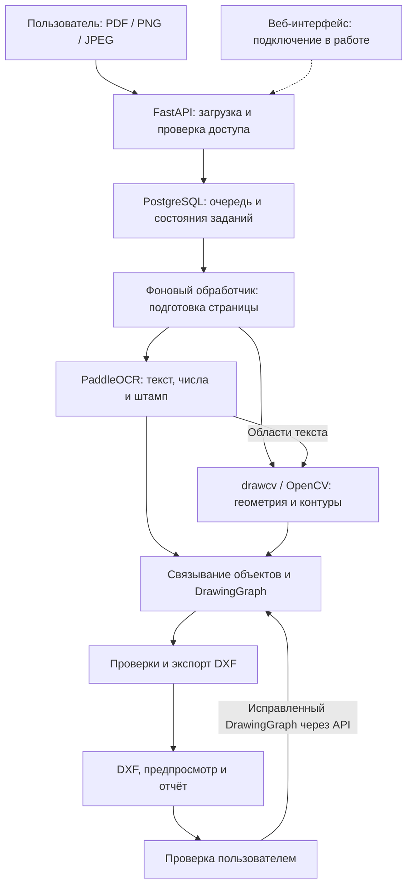
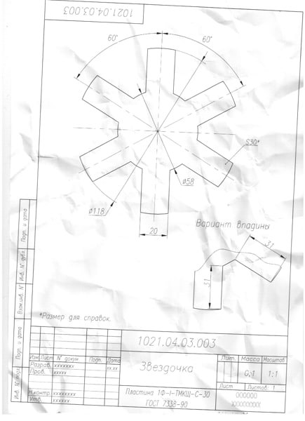
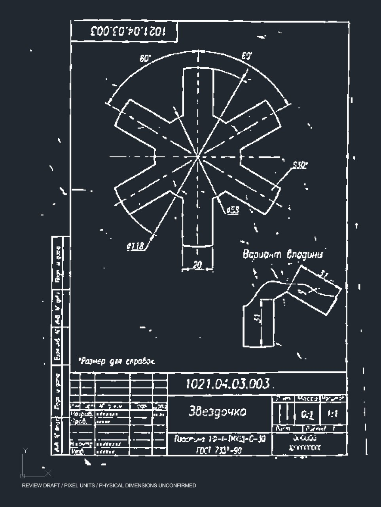
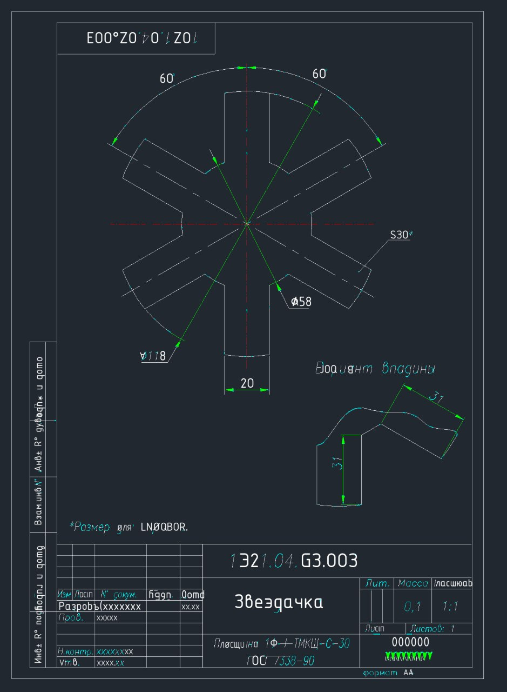

# Отчёт по проектному практикуму команды "Великолепная восьмерка"
## «Оцифровка архивов конструкторской документации для 44labs»

Ссылка на репозиторий: https://github.com/pudoff/ProjectPractice44Labs

## 1. Цель и задачи проекта
Проект выполняется по заказу компании 44labs

**Цель проекта — разработать локально развёртываемый сервис преобразования архивных чертежей в редактируемые двумерные DXF-файлы с сохранением геометрии, текста, размеров и структуры документа.** Пользователь должен загрузить чертёж, получить результат и увидеть места, требующие проверки или исправления.

Основные задачи проекта:

1. Подготовить и проверить наборы исходных чертежей и соответствующих CAD-эталонов.
2. Реализовать приём PDF, PNG и JPEG, подготовку изображения и определение масштаба.
3. Восстановить линии, окружности, дуги, контуры, оси и штриховки, отделяя геометрию детали от текста и оформления.
4. Распознать надписи, размерные числа, инженерные обозначения и поля штампа: наименование, номер документа, материал и ФИО исполнителей.
5. Связать размерные обозначения с измеряемой геометрией и сформировать самостоятельные CAD-объекты на соответствующих слоях.
6. Создать серверный конвейер, хранение исходников и результатов, пользовательский интерфейс и возможность ручного исправления.
7. Измерить качество, проверить редактируемость DXF и подготовить комплект для автономного запуска у заказчика.

Целевой результат — **редактируемый 2D-чертёж**. 

Заказчик требует соответствия размеров оригиналу. Это остаётся критерием приёмки: текущие эксперименты ещё не подтверждают его выполнение на всех входах. Предусмотрена экспертная оценка на **10 новых реальных листах**, которые не должны использоваться для настройки алгоритмов: редактируемость, полнота и чистота результата оцениваются по шкале 1–5. Ориентир времени обработки — **5–10 минут на лист**; конечная поставка должна работать без интернета. Основание: [задание](../task/Task.pdf) и [комментарии заказчика](../task/additionalComments.txt).

## 2. Команда и распределение ответственности

В команде восемь человек. Работы организованы двухнедельными спринтами с ориентировочной занятостью **до 20 часов в неделю на участника**. Имена приведены в форме, зафиксированной в [таблице ролей](../task/Roles.xlsx); 

| Участник | Роль | Чем занимается |
|---|---|---|
| Пудов Александр | Руководитель проекта | Планирует работу, определяет приоритеты, координирует участников, организует ревью, интеграцию изменений и демонстрации; контролирует выполнение и приёмку задач |
| Филипов Александр | Системный аналитик | Готовит спецификацию, пользовательские сценарии, описание форматов данных и API; согласует требования к точности, хранению, ручной проверке и приёмке |
| Зайцев Владимир | Инженер данных + инженер CAD + QA | Подготавливает и проверяет датасет, разметку и эталоны; задаёт правила CAD-представления, проверяет геометрию, качество и редактирование результатов в CAD |
| Марина Полина | MLOps/DevOps | Поддерживает окружение, Docker, зависимости и локальные веса моделей; автоматизирует проверки и сборку, готовит автономную поставку и контролирует ресурсы |
| Лесков Михаил | Backend-разработчик | Реализует API, очередь, фоновые задания, контроль доступа, хранение и версии результатов; объединяет OCR/CV и экспорт DXF, поддерживает ручной повтор обработки |
| Соловьев Максим | ML-инженер CV | Разрабатывает подготовку изображения и восстановление геометрии: линии, дуги, окружности, контуры, опорные точки, масштаб и диагностику дефектов; участвует в связывании размеров |
| Баженов Егор | ML-инженер OCR | Разрабатывает распознавание текста, чисел, специальных символов и штампа; разбор инженерных обозначений, оценку качества и совместную с CV привязку размеров |
| Громова Виктория | Frontend-разработчик | Создаёт загрузку, отображение статуса, предпросмотр, скачивание и экран проверки результатов; |

Результаты интеграции и исправлений являются командными: например, изменения OCR и размерных связей вносились также CV-инженером и при общем ревью. Назначение роли определяет ответственность за направление, а не исключительное авторство всех изменений.

## 3. Выбранная архитектура

### 3.1. Общий принцип

Выбран **гибридный модульный конвейер**. Специализированная OCR-модель читает текст, алгоритмы компьютерного зрения восстанавливают геометрию, собственные правила устанавливают связи между объектами, а отдельный экспортёр формирует DXF.

Сервер реализован как модульный монолит: API и фоновый обработчик запускаются отдельными процессами из общего Docker-образа. Они используют PostgreSQL и постоянное файловое хранилище. Такое разделение позволяет обрабатывать длительные задания без ожидания в открытом HTTP-запросе.

На схеме показаны реализованный серверный путь и место подключения сайта. Возврат исправленного описания через API уже существует; полноценный пользовательский экран исправления ещё предстоит подключить.

### 3.2. Компоненты и обмен данными

| Часть архитектуры | Назначение и текущая реализация |
|---|---|
| API на FastAPI | Принимает файлы, создаёт задания, показывает статус и историю, выдаёт результаты и принимает исправления. Доступ к заданиям ограничен их владельцем по индивидуальному токену |
| Очередь и worker | Задания хранятся в PostgreSQL; worker забирает их с блокировкой строки. Реализованы повторные запуски и обработка ряда сценариев остановки обработчика и потери связи с БД |
| Подготовка страницы | Если на вход подается векторный PDF преобразуется в растр через PyMuPDF; изображения нормализуются с учётом ориентации и прозрачности. Проверяются ограничения размера. Для растровых файлов идем по ветке сразу на модуль компьютерного зрения OpenCV |
| OCR | Локальный PaddleOCR распознаёт строки и их координаты. Дополнительные правила разбирают числа, обозначения и штамп; исходное чтение и замечания сохраняются |
| CV | Модуль `drawcv` на базе OpenCV выделяет примитивы, классифицирует линии, восстанавливает контуры и опорные точки, определяет масштаб и обнаруживает дефекты |
| DrawingGraph 0.2 | Общее структурированное описание чертежа, которое объединяет результаты OCR и CV и передаётся экспортёру |
| Экспорт и проверки | `ezdxf` создаёт DXF R2007 / AC1021 с отдельными объектами и слоями. В поддерживаемых случаях доступны текст, линейные размеры и штриховки; проверяются ссылки, геометрия и расхождения |
| Развёртывание | Docker Compose, зафиксированные зависимости, локальные файлы моделей и проверка их контрольных сумм. Базовый маршрут работает на CPU |

**DrawingGraph простыми словами** — это JSON-файл с описанием того, что находится на чертеже: координаты линий и дуг, текст, размеры, контуры, штриховки, масштаб, связи объектов и замечания. Например, размер хранится вместе со ссылками на определяющие его точки. Благодаря этому экспортёр может пересчитать измерение после изменения геометрии, а результат можно повторно сформировать без полного распознавания изображения.

Основные CAD-термины в проекте: `TEXT` — редактируемая надпись; `DIMENSION` — штатный размерный объект с определяющими точками и измерением; `HATCH` — штриховка с заданной границей. Слои позволяют независимо показывать и редактировать контур детали, оси, размеры и текст.

OCR и CV используют одну подготовленную страницу. Проверка её размера, номера и хеша нужна, чтобы координаты текста соответствовали координатам геометрии. 

**Хранение разделено по назначению.** Загруженный оригинал, DXF, предпросмотр и JSON-результаты размещаются в постоянном файловом томе. PostgreSQL хранит задания, владельцев, состояния, параметры и сведения о запусках и файлах. Повторная обработка создаёт новую версию результата. 

Состояние `needs_review` означает необходимость проверки человеком. Оно может сопровождаться DXF с замечаниями; при неизвестном масштабе экспорт может быть остановлен и DXF отсутствовать.

### 3.3. Почему выбрана эта архитектура

| Основание выбора | Практическая польза |
|---|---|
| Требуется точная и редактируемая CAD-структура | Собственный экспортёр и геометрические проверки позволяют контролировать координаты, размеры, слои и связи |
| Исходный датасет достаточно небольшой| Готовый OCR и специализированные CV-алгоритмы позволяют начать с проверяемого решения. Обучение универсального преобразователя с нуля потребовало бы существенно более разнообразных и тщательно размеченных данных и времени на реализацию. А дедлайн по проекту всего `1.5 месяца |
| Ошибки возникают на разных этапах | Разделение текста, геометрии и связей позволяет находить причину ошибки и улучшать соответствующий модуль |
| Нужны повторная обработка и ручная проверка | Выстроенный чертеж (DrawingGraph), исходные наблюдения и версии результатов дают основу для воспроизводимого исправления |
| Заказчику нужна локальная установка | Модели и зависимости поставляются вместе с сервисом; обработка не требует облачного API |

Развёртывание Qwen или другой мультимодальной VLM модели рассматривалось как вариант помощи на сложных фрагментах. **В основном реализованном маршруте Qwen и агентная обвязка отсутствуют.** Решение об их добавлении предлагается принимать после сравнения качества, времени и ресурсов на одинаковых данных. Предпочтительное направление развития — улучшение отдельных компонентов и, при необходимости, дообучение готовых моделей на конкретных ошибках.

Целевая архитектура также предусматривает прямое извлечение полезных объектов из векторного PDF. Сейчас основной серверный маршрут растеризует PDF; полноценная векторная ветка и обработка сложных многостраничных документов остаются развитием. 
## 4. Какие шаги уже сделаны

| Направление | Выполненная работа и полученный результат |
|---|---|
| Постановка и планирование | Изучены требования и комментарии заказчика, определены границы MVP, распределены восемь ролей, подготовлены архитектура, спецификация, планы спринтов и критерии проверок |
| Данные | Подготовлены очищенные данные и дополнительные наборы. В текущих каталогах находятся 510 DXF и 510 PNG в `clear_sum_dataset`, а также 513 PDF и 513 DXF в `pairs_pdf-dxf`. Ранее проведён аудит единиц, имён и содержимого DXF; окончательная проверка соответствия пар и независимости наборов продолжается |
| Первые конвертации и CAD-структура | Выполнены эксперименты с PDF, сканами и PNG. На примере клапана уточнено требование к отдельным контурам, тексту, размерам и штриховкам. |
| CV | Реализован модуль `drawcv` из решения OpenCV: подготовка изображения, геометрические примитивы, роли линий, контуры, опорные точки и диагностика. Улучшены фактическое замыкание контуров и ограничения на размер входного изображения |
| OCR | Подключён локальный модуль PaddleOCR, реализованы разбор текста и обозначений, кандидаты полей штампа, исправления знака диаметра и курсивной «т». Исходные чтения и применённые исправления сохраняются |
| Общий серверный маршрут | OCR и CV объединены через общую страницу и DrawingGraph. Реализованы API, очередь PostgreSQL, проверка владельца задания, история и повторная обработка. |
| Экспорт | Реализованы отдельные CAD-сущности и слои, линейные размеры и штриховки в поддерживаемых случаях, предпросмотр и отчёт о проблемах. Проверен повторный экспорт после изменения геометрии |
| Развёртывание | Собраны общий контейнер и Compose-конфигурация, подключены локальные модели, проверка их файлов и автоматизированные проверки. Проведены локальные запуски OCR/CV без загрузки моделей из сети |
| Интерфейс | Созданы страницы, выбор и перетаскивание файла, состояния формы, темы и адаптивная вёрстка. Подключение к настоящему API и выдача серверного результата пока не завершены |
| Ревью и эксперименты | Проведены ревью CV, OCR, backend, DevOps и frontend; сохранены воспроизведения ошибок и следующие задачи. Выполнена пробная конвертация сложной фотографии и разобрана архитектура альтернативного решения |

Числа файлов в разных наборах не складываются в количество уникальных деталей: наборы могут пересекаться. Совпадение числа PDF и DXF также не подтверждает правильность каждой пары.

## 5. Результаты и метрики качества

### 5.1. Работоспособность конвейера и CAD-экспорта

При проверке интеграции контрольные **PNG, JPEG и PDF** прошли через настоящий HTTP API, PostgreSQL, worker, OCR и CV до формирования результатов. Для них получен статус `needs_review`: серверный маршрут работает, но диагностика выявляет места для проверки.

На вручную заданном контрольном DrawingGraph подтверждено создание нативных `DIMENSION` и `HATCH` с отверстием. Изменение определяющей геометрии **с 46 до 47 мм** отразилось в измерении, а предыдущая версия результата сохранилась. Этот опыт проверяет экспортёр и версии, но не автоматическое извлечение размера из изображения и не ассоциативное редактирование в конкретной CAD.

В проверке прошли **150 модульных тестов**, отдельно **77 проверок с PostgreSQL** и **90 тестов CV**. Наборы частично пересекаются, поэтому они не суммируются в общее число уникальных тестов. 

### 5.2. Геометрия и контуры

При сравнении на 28 одинаковых входах доля замкнутых контуров, принятых геометрической проверкой backend, выросла **с 283/789 (35,9%) до 709/710 (99,9%)**. При этом с эталоном совпали **132 из 246 контуров**, а точность среди выданных замкнутых контуров составила около **19%**. Улучшена корректность соединения рёбер; полнота восстановления и отделение контура детали от лишней графики ещё требуют работы. Источник: [отчёт CV](../mlcv/eval/REPORT.md).

В отдельном сохранённом эксперименте получены следующие результаты:

| Контрольный лист | Найдено эталонных отрезков | Найдено эталонных контуров | Ошибка масштаба | Время CV |
|---|---:|---:|---:|---:|
| `болт1` | 66 из 104 | 3 из 7 | 0,012% | ≈16 с |
| `Bolti 193-83_1` | 41 из 57 | 2 из 11 | 0,039% | ≈14 с |
| `переходник` | 43 из 56 | 2 из 7 | 0,007% | ≈13 с |

Примитив засчитывался при покрытии не менее 80% его длины в пределах 0,5 мм; контуры сопоставлялись один к одному при перекрытии площадей не менее 90%. Эти пороги являются настройками эксперимента, а не согласованными производственными допусками. Малая ошибка масштаба не означает такую же точность всех координат.  Источник: [разбор трёх листов](../mlcv/eval/three_sheets/REPORT.md).

### 5.3. OCR и связь размеров

На трёх контрольных фрагментах после коррекции правильно восстановлены **3 из 3 строк**: `Ø32`, `8отв.Ø4`, `Ст3 ГОСТ 380-2005`. Доля ошибок по символам — CER — снизилась **с 24% до 0%** на 25 учитываемых символах без пробелов. Это небольшой регрессионный набор, использовавшийся при исправлениях; результат не переносится на весь датасет. 

В отчёте OCR указаны **324 точных чтения из 448 сопоставлений — 72,32%** на 33 листах. Однако ревью показало, что оценка исключает часть пропусков и плохих совпадений и допускает повторное использование эталона. Поэтому показатель приводится только как предварительный и **не считается общей точностью OCR**.

Для размерных связей результат эксперимента показал  **143 из 168** при идеальном чтении текста и **94 из 168** при настоящем OCR, из которых 88 подтверждены текущим сравнением. В ревью обнаружены ложные связи и проблемы оценочного скрипта, поэтому показатели также требуют пересчёта. Источники: [данные OCR](../mlocr/evaluation/references_score.json), [отчёт CV](../mlcv/eval/REPORT.md), [результаты ревью](code-review-ocr-backend-frontend-2026-11-09.md).

### 5.4. Производительность и проба на фотографии

По сохранённому отчёту разработчика полный серверный маршрут для листа **A3 при 600 dpi занял около 36 секунд на CPU**. Лист **A1 при 600 dpi — около 17 минут**, память worker составила примерно **2,7 ГБ**. Большой лист превышает ориентир заказчика 5–10 минут и требует оптимизации. Это отдельные замеры, а не нагрузочное испытание. Источник: [отчёт CV и общего сервиса](../mlcv/eval/REPORT.md).

Дополнительно проведена конвертация чертежа photo_2026-11-09_14-20-31.jpg размером 435×600 пикселей. Автоматический запуск занял около **80 секунд** и остановил экспорт из-за неизвестного масштаба. После условной ручной калибровки для просмотра получен DXF с **732 отрезками, 43 дугами и 31 текстовым объектом**, но без `DIMENSION` и `HATCH`. Повторное чтение и аудит файла дали **0 ошибок и 0 автоматических исправлений**.

При этом контур фотографии восстановлен фрагментарно, остались ошибки OCR, а физический масштаб не подтверждён. Структурно корректный DXF в данном случае не является точным чертежом детали.

**Полученные результаты по итогу пробы:**

1. **Исходный чертёж в формате JPG.**

   

2. **Результат экспорта в DXF:** [jpg-page-001.dxf](jpg-page-001.dxf).

3. **Результат импорта в CAD систему.**

   

4. **Результат альтернативного конвейера.**

   

### 5.5. Что ещё не подтверждено приёмкой

На дату отчёта нет единой принятой оценки точности всего сервиса на независимых реальных листах. Остаются открытыми достоверные общие метрики OCR и размерных связей, а также протокол редактирования и повторного сохранения в конкретных версиях CAD систем.

## 6. Следующие задачи

Ниже приведены основные направления без подробных  уточнений по задачам.

| Основная задача | Для какой части архитектуры нужна | Ответственные |
|---|---|---|
| Завершить реестр данных, проверку пар, единиц и независимое разделение выборок | Общая основа разработки и воспроизводимой оценки OCR/CV | Данные + CAD + QA, аналитик |
| Уточнить критерии точности, масштабов и ручного подтверждения | Спецификация и правила принятия результата | Аналитик, CAD + QA, техлид |
| Повысить полноту и чистоту геометрии, улучшить дуги, контуры и отделение штриховки | CV и подготовка геометрии для DrawingGraph | CV, CAD + QA |
| Улучшить чтение инженерных символов, составных обозначений и штампа | OCR и структурированные поля документа | OCR, CAD + QA |
| Исправить ложные связи размеров и работу с разными масштабами видов | Объединение OCR/CV, DrawingGraph и проверка размеров | OCR, CV, backend, аналитик |
| Отделить геометрический допуск от округления надписи и постепенно расширить виды размеров | Корректный экспорт и контроль измерений | Backend, CAD + QA, OCR |
| Сохранять точный рабочий растр, журнал ручных изменений и основание версии | Хранилище и повторная обработка после проверки | Backend, DevOps |
| Подключить сайт к API, показать замечания, исправления и реальные файлы | Основной пользовательский интерфейс | Frontend, backend |
| Пересчитать метрики с учётом пропусков и лишних объектов; провести CAD-испытания | Контроль качества и приёмка | Данные + CAD + QA, CV, OCR, техлид |
| Ускорить большие листы и проверить полный офлайн-комплект на другом компьютере | Производительность и автономное развёртывание | DevOps, CV, OCR, backend |
| Добавить VK-бота после стабилизации сайта | Дополнительный интерфейс к общему API | Frontend, backend |
| Сравнить другие варианты CV и OCR, оценить векторный PDF и VLM | Последующее развитие распознавания на основании измерений | CV, OCR, аналитик, техлид |

Ближайшая последовательность работ: устранить подтверждённые дефекты связей, метрик и хранения; подключить настоящий пользовательский маршрут; повторить оценку на согласованных данных и провести CAD-проверку; затем подтвердить автономную поставку и подготовить итоговое испытание на новых листах заказчика.

Текущий этап проекта — **работающий серверный прототип с измеренными результатами отдельных компонентов**. Следующая общая веха — сквозной пользовательский сценарий с ручной проверкой и воспроизводимым подтверждением качества на реальных чертежах.
