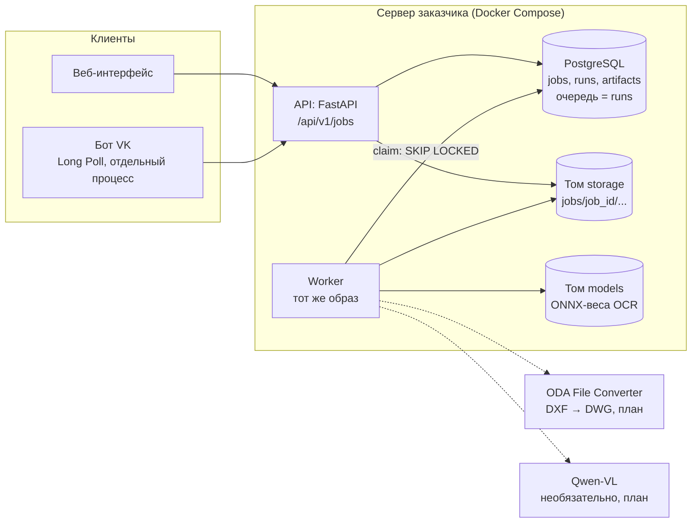
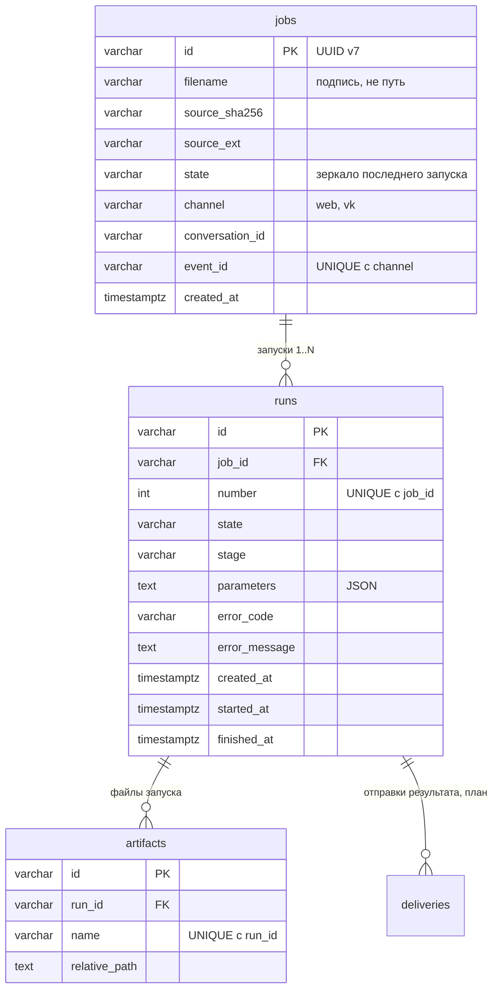
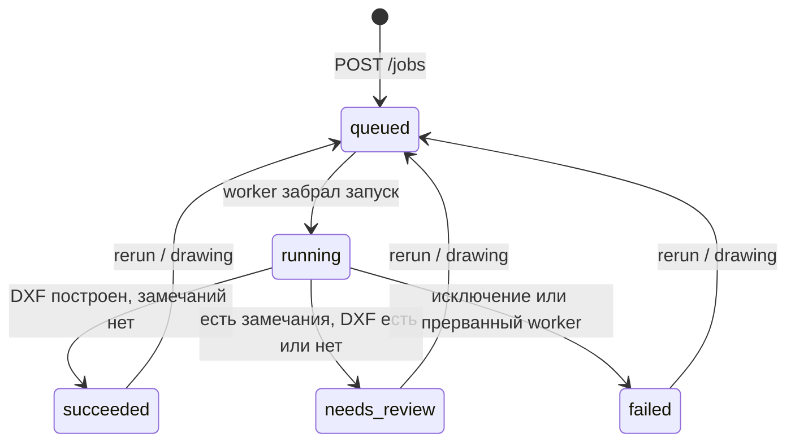

# Спецификация MVP: оцифровка чертежей (скан / PDF → редактируемый DXF → DWG)


## 0. Как читать документ

### 0.1. Пометки

Каждое требование и поле помечено, чтобы было видно, что уже работает, а что только предстоит сделать:

| Пометка | Значение |
|---|---|
| **[есть]** | Реализовано в `backend/` и подтверждено кодом или тестами (`backend/tests/test_service.py`) |
| **[план]** | Описано в `ARCHITECTURE.md` или в задачах, в коде ещё нет. В этой спецификации предложен контракт |
| **[решить]** | Нужно решение команды или ответ заказчика / CAD-эксперта (вопросы собраны в разделе 8) |

Числа, которых нет в документах проекта, помечены **[предл.]**.

### 0.2. Соответствие пунктам задачи

| Пункт задачи | Раздел |
|---|---|
| 1.1 Архитектура, workflow, библиотеки | [2](#2-архитектура-и-workflow) |
| 1.2 Структура СУБД | [3](#3-структура-субд-postgresql) |
| 1.3 Загрузка через веб и бота VK, ожидание, результаты, формат и размеры файлов, что менять в CAD | [4](#4-загрузка-и-сценарии-пользователя) |
| 1.4 Формат чертежа | [5](#5-формат-чертежа-drawinggraph) |
| 1.5 API, хранение, состояния | [6](#6-api-хранение-и-состояния-задания) |
| 1.6 Критерии приёмки и повторные проверки | [7](#7-критерии-приёмки-и-повторные-проверки) |

### 0.3. Как проверены примеры

JSON-примеры раздела 5 загружены в реальную схему `backend/app/domain/drawing.py` (`DrawingGraph`) и прогнаны через реальный `DxfExporter` из `backend/app/services/dxf.py`. Библиотека `ezdxf` при этой проверке была заменена записывающей заглушкой (в среде подготовки нет доступа к PyPI). Поэтому подтверждены схема, статусы, коды замечаний и состав объектов DXF по слоям. Реальный файл DXF и его открытие в CAD при подготовке документа **не проверялись**, это входит в приёмку (T-09, T-14).

### 0.4. Расхождения между документами проекта и принятые допущения

Документы проекта местами противоречат друг другу. В этой спецификации принято следующее (если не оговорено иное, это допущение, и его нужно подтвердить):

| № | Вопрос | Что в документах | Принято в спецификации |
|---|---|---|---|
| D-1 | Стек | Доска/задача: FastAPI → OpenCV + PaddleOCR → Qwen-VL → DXF → DWG. Репозиторий: OpenCV, **RapidOCR** (модель PP-OCRv5 из семейства PaddleOCR, запуск через ONNX Runtime), Qwen3-VL-4B — необязательный модуль «только если даст выигрыш на регрессии» | Распознавание текста — модели PP-OCRv5 через RapidOCR/ONNX (офлайн). Qwen-VL — необязательный модуль **[план]**. DWG — отдельный шаг после DXF **[план]** |
| D-2 | Версия DXF | ТЗ: AC1021 (AutoCAD 2007). «Понятия CAD.docx»: «2010 или новее». Код: `R2007` | **AC1021 (R2007)**, как требует ТЗ |
| D-3 | Слои | ТЗ: пять слоёв `MAIN/THIN/AXIS/DIMS/TEXT`. `CAD_OBJECT_SPEC.md` и .docx добавляют `HATCH` и `CONSTRUCTION`. Код: штриховка кладётся на `THIN` | MVP — **пять слоёв по ТЗ**, штриховка на `THIN`, скрытые линии = `THIN` + тип `DASHED`. Слой `HATCH` — возможный дополнительный профиль экспорта **[решить]** |
| D-4 | Цвета слоёв | Код: `DIMS` = 4, `TEXT` = 7. `CAD_OBJECT_SPEC.md`: `DIMS` = 5, `TEXT` = 0 | Профиль `eskd_tz` берёт значения из кода (таблица 5.2). Согласовать с заказчиком **[решить]** |
| D-5 | СУБД и хранилище | `ARCHITECTURE.md`: «SQLite → PostgreSQL». `terms-and-data-storage.md` и код: PostgreSQL + каталог на диске | **PostgreSQL + файловая система сервера**. Очередь — таблица `runs` в PostgreSQL (`SKIP LOCKED`), Redis не нужен |
| D-6 | Реестр файлов | `terms`: тип, путь, размер, хеш. Код: после миграции `8d42f1c9a716` остались только имя и путь | Оставить как в коде: хеш хранится только у исходника (`jobs.source_sha256`) **[решить]** |
| D-7 | Повторная обработка | Создаёт новый **запуск (run)** того же задания, а не новое задание | Так и описано в разделе 6.5 |
| D-8 | Масштаб на листе | Профиль `eskd_tz`: лист 1:1 в мм бумаги, `DIMLFAC = 1/масштаб`. Профиль `natural`: натуральные мм, лист в Layout | **`eskd_tz`**: так устроены 30 из 36 архивных DXF заказчика |
| D-9 | Форматы входа | ТЗ: PDF/JPEG/PNG. `ARCHITECTURE.md`: ещё и TIFF. Backend: PDF (1 страница), PNG, JPEG | **PDF (1 страница), PNG, JPEG**. TIFF не входит в MVP |
| D-10 | Название формата | `terms`: «DrawingGraph», по-русски «описание чертежа», файл `drawing.json` | Используется это название |
| D-11 | Бот VK | `terms`: события через Long Poll, бот отделён от основного сервиса, один и тот же API | Бот — отдельный процесс на Long Poll |
| D-12 | Диаметральные размеры | ТЗ: линейные и диаметральные. Backend: размер только `linear`; `radius` и другие дают замечание `unsupported_object` | Диаметр передаётся линейным размером с `display = "%%c<>"` (так сделаны реальные DXF заказчика). Радиусные и угловые размеры — **[план]** |

---

## 1. Цель, границы и требования MVP

### 1.1. Цель

На входе — скан или фото чертежа по ЕСКД (PDF/PNG/JPEG). На выходе — **редактируемый DXF** (затем DWG): геометрия, размеры как настоящие `DIMENSION`, штриховки, текст и штамп на русском, формат листа и масштаб как в оригинале. Результат открывается в AutoCAD, LibreCAD, nanoCAD, КОМПАС. Пользователь заранее видит, где распознавание сомнительно: сервис не подставляет выдуманные значения, а записывает замечание.

### 1.2. Вне MVP

- Авторизация и личный кабинет (backend README: «не входит в текущую задачу»; достаточно ограниченного доступа на стенде).
- TIFF, многостраничные PDF, пакетная обработка потока архива (архитектуру нужно заложить «с запасом», реализация не требуется).
- Рукописные ФИО исполнителей (дополнительная задача ТЗ), подписи и печати (заказчик: «не нужны»).
- Допуски формы и расположения, шероховатость и таблицы: распознаются только как обычный текст.
- Редактор `drawing.json` в интерфейсе (этап 2 плана).

### 1.3. Таблица требований MVP

Приоритет: **M** — обязательно, **S** — желательно. Источники: **ТЗ** — `task/Task.pdf`; **О-n** — пункт n ответов заказчика (`task/additionalComments.txt`); **Арх** — `ARCHITECTURE.md`.

| ID | Требование | Источник | Реализация | Приор. | Проверка |
|---|---|---|---|---|---|
| R-01 | Загрузка PDF (одна страница), PNG, JPEG через веб-интерфейс и скачивание DXF | ТЗ | API **[есть]**, веб-интерфейс **[план]** | M | T-11 |
| R-02 | Загрузка через бота VK; результат возвращается в тот же диалог | ТЗ, `terms` §5 | API (`channel`, `conversation_id`, `event_id`) **[есть]**, бот **[план]** | M | T-11 |
| R-03 | Проверка расширения, сигнатуры файла и размера до постановки в очередь, понятное сообщение об отказе | `terms` §3 | **[есть]** (25 МиБ). Число страниц PDF и минимальное разрешение проверяются позже или не проверяются **[план]** | M | T-11 |
| R-04 | Асинхронная обработка, пять статусов: «в очереди», «обрабатывается», «готово», «нужна проверка», «ошибка» | задача 1.5 | Значения `queued/running/succeeded/needs_review/failed` **[есть]**, русские подписи в интерфейсе **[план]** | M | T-10 |
| R-05 | Показ текущего этапа обработки | задача 1.3 | `runs.stage` (`prepare/recognize/export/done`) **[есть]** | S | T-10 |
| R-06 | DXF AC1021, UTF-8, миллиметры, слои `MAIN/THIN/AXIS/DIMS/TEXT` | ТЗ | **[есть]**. Типы линий (`CENTER`, `DASHED`) не назначаются **[план]** | M | T-01 |
| R-07 | Геометрия: отрезки, окружности, дуги, полилинии | ТЗ | **[есть]** | M | T-02 |
| R-08 | Размеры — настоящие `DIMENSION` со значением, вычисленным по геометрии (подпись `<>`) | ТЗ, О-1, О-4 | Линейные и диаметральные через `%%c<>` **[есть]**. Радиус, угол **[план]** | M | T-04 |
| R-09 | Нет совпадения «подпись ≠ геометрия» молча: расхождение и нерешённая связь попадают в замечания, `DIMENSION` не подделывается | `terms` §1 | **[есть]** | M | T-05 |
| R-10 | Штриховка — объект `HATCH` с внешним контуром, отверстиями, рисунком, углом и шагом | ТЗ | **[есть]**. Граница штриховки по граням топологии **[план]** | M | T-06 |
| R-11 | Текст — объекты `TEXT`, кириллица без искажений | ТЗ | **[есть]**. `MTEXT` **[план]** | M | T-03 |
| R-12 | Формат листа и масштаб считываются с оригинала и записываются в DXF | О-2 | Масштаб (`scale_status`, `view_scale`, `DIMLFAC`) **[есть]**. Формат листа **[план]** | M | T-07 |
| R-13 | Штамп обязателен: наименование, номер документа, материал, ФИО исполнителей | О-9 | **[план]** | M | T-08 |
| R-14 | Все размеры в DXF точны и соответствуют распознанному оригиналу | О-4 | Расхождение > 0,1 мм фиксируется как замечание **[есть]**. Решатель ограничений **[план]** | M | T-04 |
| R-15 | `preview.png` и `report.json` с перечнем замечаний | `terms` §3 | **[есть]** | M | T-10 |
| R-16 | Повторная обработка без повторной загрузки; загрузка исправленного `drawing.json` | `terms` §3 | **[есть]**. Параметры повторного запуска (масштаб, формат) **[план]** | M | T-12 |
| R-17 | Идемпотентность входящих событий бота (повтор `event_id` возвращает то же задание) | `terms` §3 | **[есть]** | M | T-11 |
| R-18 | Восстановление прерванных запусков: статус «ошибка» с понятной причиной и возможность повторить | `terms` §3 п. 3 | **[есть]** (`worker_interrupted`) | M | T-12 |
| R-19 | Файлы — на диске сервера, метаданные и состояния — в PostgreSQL; запись файлов атомарная | `terms` §3 | **[есть]** | M | T-13 |
| R-20 | Конвертация DXF → DWG, DWG открывается в CAD | ТЗ (доп. задача) | Скрипты `docker/oda-convert` **[есть]**, шаг в backend и `result.dwg` **[план]**, лицензия ODA **[решить]** | S | T-09 |
| R-21 | Установка без интернета из комплекта поставки: Docker-образы и веса моделей; CPU или одна GPU 16–24 ГБ; до 5–10 минут на лист | О-7, О-11 | Compose **[есть]**. Веса OCR сейчас скачиваются при первом запуске worker **[план: включить в образ]** | M | T-15 |
| R-22 | Качество: совпадение геометрии с эталоном, точность размеров, экспертная оценка 1–5 по трём критериям на 10 реальных листах | ТЗ, О-5 | Процедура описана в разделе 7 | M | T-02, T-04, T-16 |
| R-23 | Устойчивость к низкокачественным сканам (поворот, шум, размытие, 150–230 dpi) | ТЗ | Частично, см. раздел 7.3 | S | T-17 |
| R-24 | Документы проекта указывают, что работа выполнена совместно с 44labs | О-10 | Отметка в README и в этой спецификации | S | — |

---

## 2. Архитектура и workflow

### 2.1. Общая схема



Веб-интерфейс и бот работают с одним API. Бот добавляет получение вложения, связь задания с диалогом и отправку результата; собственного распознавания у него нет. Сервер и веб-интерфейс должны работать без интернета. Бот требует интернета и включается отдельно.

### 2.2. Принципы

1. **`DrawingGraph` — центральный контракт.** Распознаватели только добавляют в него наблюдения, экспортёр только читает принятую версию. Заменить OCR или правила DXF можно, не трогая остальное.
2. **Допуски задаются в миллиметрах листа**, а не в пикселях (эксперименты показали, что пиксельные константы с 600 dpi на 200 dpi стирали 86 % чернил).
3. **Подпись и измерение — разные вещи.** Число, прочитанное на чертеже, не подменяет длину, посчитанную по геометрии. Расхождение — запись в `issues` (раздел 5.6).
4. **Детерминированное ядро + заменяемые распознаватели.** Правила работают сразу, обучаемые модели и VLM подключаются там, где правила измеримо проигрывают.
5. **Офлайн.** В рабочем контуре нет облачных вызовов; облачные OCR/ML допустимы только на этапе разработки и экспериментов (О-7).
6. **Каждое изменение проверяется регрессией** на фиксированном наборе (раздел 7.3).

### 2.3. Workflow: этапы запуска (run)

Worker забирает запуск из очереди и проходит этапы. Пользователь видит `runs.stage`.

| `stage` | Что делает | Реализация | Артефакты | Статус реализации |
|---|---|---|---|---|
| `queued` | Запуск ждёт worker | Строка `runs` со `state = queued` | `original.<ext>` (исходник, только у запуска № 1) | **[есть]** |
| `prepare` | Загрузка исходника. PDF рендерится в PNG 300 dpi (PyMuPDF, ровно 1 страница), PNG/JPEG приводятся к RGB (Pillow) | `services/image.py` | `pages/page-001.png` (служебный) | **[есть]** |
| `recognize` | Геометрия (OpenCV, scikit-image, SciPy) и текст/размеры (RapidOCR, PP-OCRv5, ONNX Runtime) → наблюдения `cv.json`, `ocr.json` → сборка `drawing.json` | `services/recognition.py`, встроенный конвейер `runs/klapan_png2dxf/pipeline_b` либо внешние адаптеры `CV_ADAPTER` / `OCR_ADAPTER` | `cv.json`, `ocr.json`, `drawing.json` | **[есть]** |
| `export` | Проверки, запись DXF (ezdxf), предпросмотр, `report.json`, определение итогового статуса | `services/dxf.py`, `services/preview.py` | `result.dxf`, `preview.png`, `report.json` | **[есть]** |
| `done` | Файлы зарегистрированы, статус итоговый | `tasks/job.py` | — | **[есть]** |

Запланированная детализация (по `ARCHITECTURE.md` §2.1) **[план]**: регистрация листа по шаблону ГОСТ 2.301/2.104 (рамка, штамп 185×55, формат, масштаб), символы (стрелки, шероховатость), топология (грани, замыкание зазоров < 0,3 мм), штриховки по граням, аннотации (радиусы, углы, выноски), штамп, решатель ограничений («размеры = точно, пиксели = наблюдения»), контроль выходного DXF, конвертация DWG (`result.dwg`), необязательный VLM для трудных фрагментов. Каждый этап должен записывать контрольную точку, чтобы повтор мог начинаться с упавшего этапа.

**Роль VLM** (если будет включён): получает только фрагменты изображения, текст OCR и список кандидатов с идентификаторами и возвращает выбор кандидата. Координаты итогового чертежа он не создаёт, а любой идентификатор вне списка кандидатов отбрасывается.

### 2.4. Библиотеки и фреймворки

| Область | Выбор | Назначение |
|---|---|---|
| API | FastAPI 0.116, Uvicorn, python-multipart, Pydantic 2, pydantic-settings | HTTP-контракт, валидация, конфигурация через переменные окружения |
| БД | PostgreSQL 16, SQLAlchemy 2 (asyncio), psycopg 3, Alembic | Состояния заданий и запусков, миграции |
| Очередь | Таблица `runs` в PostgreSQL, `SELECT … FOR UPDATE SKIP LOCKED` | Redis/RQ/Dramatiq для текущей нагрузки не нужны |
| Подготовка изображения | PyMuPDF (PDF → PNG 300 dpi), Pillow | Одностраничный PDF и растры |
| Геометрия | OpenCV, scikit-image, SciPy, NumPy | Калибровка листа, линии, дуги, окружности, штриховки |
| OCR | RapidOCR 3.x + ONNX Runtime, модель `eslav_PP-OCRv5_rec_mobile.onnx` | Чтение букв, чисел, символов размеров |
| VLM (необязательно) | Qwen3-VL-4B | Трудные фрагменты **[план]** |
| Запись CAD | ezdxf 1.4 | DXF AC1021, `DIMENSION`, `HATCH`, `TEXT` |
| DXF → DWG | ODA File Converter (`docker/oda-convert`) | Дополнительная задача; лицензия — **[решить]** |
| Проверка в CAD | LibreCAD (`docker/cad-validate`), матрица ручных проверок | Раздел 4.6 |
| Бот VK | Клиент VK API (Long Poll) **[решить: библиотека]** | Получение вложений, отправка файлов |
| Тесты | pytest, httpx, aiosqlite | `backend/tests/test_service.py` |
| Поставка | Docker Compose: `db` (postgres:16), `api`, `worker`, `migrate` (профиль `tools`); тома `pgdata`, `storage`, `models` | Установка на площадке заказчика |

Backend — слоистый монолит (один API, один worker, общие PostgreSQL и хранилище): `api/v1`, `schemas` → `use_cases` → `domain` (`DrawingGraph`), `services` (изображение, сборка графа, экспорт DXF, предпросмотр) → `repositories`/`uow` → `infra` (SQLAlchemy, файловое хранилище, CV-адаптер), `tasks`/`worker`.

### 2.5. Выходные файлы

| Файл (`name` артефакта) | Содержимое | Когда есть |
|---|---|---|
| `original.<ext>` | Исходник без изменения байтов | Всегда, у запуска № 1 |
| `cv.json`, `ocr.json` | Наблюдения геометрии и текста до сборки | После распознавания (не создаются при запуске по загруженному `drawing.json`) |
| `drawing.json` | Полное описание чертежа (`DrawingGraph`) | После распознавания |
| `result.dxf` | Итоговый DXF | Только если DXF удалось построить (раздел 6.4) |
| `preview.png` | Изображение полученного DXF | Если DXF построен и предпросмотр создан |
| `report.json` | Статус, замечания, хеш исходника; при ошибке — код и сообщение | Всегда (кроме сбоя записи отчёта) |
| `result.dwg` | DXF, сконвертированный в DWG | **[план]** |
| `overlay.png` | Наложение результата на исходник для проверки | **[план]** |

---

## 3. Структура СУБД (PostgreSQL)

Принцип: в PostgreSQL лежат учёт заданий, запусков и ссылок на файлы; **содержимое файлов — на диске**. Полный `drawing.json` хранится в файле, а не второй редактируемой копией в базе (иначе непонятно, какая версия правильная).

### 3.1. Схема



### 3.2. Таблицы (текущее состояние, миграции `41ece228ff73` + `8d42f1c9a716`)

| Таблица | Поле | Назначение |
|---|---|---|
| `jobs` | `id` | Внешний идентификатор (UUID v7 в виде строки, создаёт PostgreSQL) |
| | `filename` | Имя исходника для отображения. В пути не используется |
| | `source_sha256`, `source_ext` | Проверка совпадения при ручной правке графа; поиск исходного файла (`original<ext>`) |
| | `state` | Быстрый статус задания; всегда равен состоянию **последнего** запуска |
| | `channel`, `conversation_id`, `event_id` | Источник (`web`, `vk`), диалог и идентификатор входящего события; пара (`channel`, `event_id`) уникальна — повторная доставка события возвращает то же задание |
| | `created_at` | Время создания |
| `runs` | `id`, `job_id`, `number` | Один запуск обработки; номера 1, 2, 3… внутри задания (уникальны) |
| | `state`, `stage` | Выбор задания worker'ом и прогресс |
| | `parameters` | JSON-строка. Сейчас: `{"drawing_path": true}`, если запуск создан по загруженному графу |
| | `error_code`, `error_message` | Диагностика сбоя (`error_code` сейчас — имя класса исключения или `worker_interrupted`) |
| | `created_at`, `started_at`, `finished_at` | Порядок и длительность обработки |
| `artifacts` | `id`, `run_id`, `name`, `relative_path` | Файл запуска: имя (уникально в запуске) и путь относительно корня хранилища |

Допустимые значения (в БД ограничений нет, значения задаёт код):

| Поле | Значения |
|---|---|
| `jobs.state`, `runs.state` | `queued`, `running`, `succeeded`, `needs_review`, `failed` |
| `runs.stage` | `queued`, `prepare`, `recognize`, `export`, `done` |
| `jobs.channel` | `web` (по умолчанию), `vk`, другие каналы до 32 символов |

Индексы: `ix_runs_job_id`, `ix_runs_state`, `ix_artifacts_run_id`; уникальные `uq_channel_event`, `uq_run_number`, `uq_run_artifact`.

### 3.3. DDL текущей схемы

```sql
CREATE EXTENSION IF NOT EXISTS pgcrypto;

CREATE FUNCTION uuid_generate_v7() RETURNS text
LANGUAGE sql VOLATILE AS $$
  SELECT (
    lpad(to_hex(floor(extract(epoch FROM clock_timestamp()) * 1000)::bigint), 12, '0') ||
    '7' || substr(encode(gen_random_bytes(2), 'hex'), 2, 3) ||
    substr('89ab', floor(random() * 4)::int + 1, 1) ||
    substr(encode(gen_random_bytes(8), 'hex'), 2, 15)
  )::uuid::text
$$;

CREATE TABLE jobs (
    id              varchar(36) PRIMARY KEY DEFAULT uuid_generate_v7(),
    filename        varchar(255) NOT NULL,
    source_sha256   varchar(64)  NOT NULL,
    source_ext      varchar(8)   NOT NULL,
    state           varchar(20)  NOT NULL DEFAULT 'queued',
    channel         varchar(32)  NOT NULL DEFAULT 'web',
    conversation_id varchar(255),
    event_id        varchar(255),
    created_at      timestamptz  NOT NULL DEFAULT now(),
    CONSTRAINT uq_channel_event UNIQUE (channel, event_id)
);

CREATE TABLE runs (
    id            varchar(36) PRIMARY KEY DEFAULT uuid_generate_v7(),
    job_id        varchar(36) NOT NULL REFERENCES jobs(id) ON DELETE CASCADE,
    number        integer     NOT NULL,
    state         varchar(20) NOT NULL DEFAULT 'queued',
    stage         varchar(40) NOT NULL DEFAULT 'queued',
    parameters    text        NOT NULL DEFAULT '{}',
    error_code    varchar(80),
    error_message text,
    created_at    timestamptz NOT NULL DEFAULT now(),
    started_at    timestamptz,
    finished_at   timestamptz,
    CONSTRAINT uq_run_number UNIQUE (job_id, number)
);
CREATE INDEX ix_runs_job_id ON runs (job_id);
CREATE INDEX ix_runs_state  ON runs (state);

CREATE TABLE artifacts (
    id            varchar(36) PRIMARY KEY DEFAULT uuid_generate_v7(),
    run_id        varchar(36) NOT NULL REFERENCES runs(id) ON DELETE CASCADE,
    name          varchar(80) NOT NULL,
    relative_path text        NOT NULL,
    CONSTRAINT uq_run_artifact UNIQUE (run_id, name)
);
CREATE INDEX ix_artifacts_run_id ON artifacts (run_id);
```

### 3.4. Предлагаемые изменения **[план]**

| № | Изменение | Зачем |
|---|---|---|
| P-1 | `CHECK` на `jobs.state`, `runs.state`, `runs.stage` | Опечатка в статусе сейчас не отлавливается базой. Миграция не меняет данные |
| P-2 | Таблица `deliveries` — отправки результата в канал | `terms` §3: «какое событие уже принято, отправлен ли ответ». Без неё бот не может надёжно повторить отправку и не может избежать дубля при перезапуске |
| P-3 | Задокументировать `runs.parameters` как JSON: `drawing_path` (есть), `scale` (`"1:5"`), `sheet` (`"A3"`), `profile` — для повторного запуска с параметрами | Требование R-12/R-16; тип можно оставить `text` или перейти на `jsonb` |
| P-4 | Не добавлять отдельные таблицы для замечаний | Замечания лежат в `report.json` и `drawing.json`. Индексировать их для поиска можно позже (`terms` §3) |

```sql
-- P-1
ALTER TABLE jobs ADD CONSTRAINT jobs_state_chk
    CHECK (state IN ('queued', 'running', 'succeeded', 'needs_review', 'failed'));
ALTER TABLE runs ADD CONSTRAINT runs_state_chk
    CHECK (state IN ('queued', 'running', 'succeeded', 'needs_review', 'failed'));
ALTER TABLE runs ADD CONSTRAINT runs_stage_chk
    CHECK (stage IN ('queued', 'prepare', 'recognize', 'export', 'done'));

-- P-2
CREATE TABLE deliveries (
    id          varchar(36) PRIMARY KEY DEFAULT uuid_generate_v7(),
    run_id      varchar(36) NOT NULL REFERENCES runs(id) ON DELETE CASCADE,
    channel     varchar(32) NOT NULL,
    kind        varchar(20) NOT NULL CHECK (kind IN ('accepted', 'result', 'error')),
    status      varchar(20) NOT NULL DEFAULT 'pending' CHECK (status IN ('pending', 'sent', 'failed')),
    attempts    smallint    NOT NULL DEFAULT 0,
    external_id varchar(255),
    error       text,
    created_at  timestamptz NOT NULL DEFAULT now(),
    sent_at     timestamptz,
    CONSTRAINT uq_delivery UNIQUE (run_id, kind)
);
CREATE INDEX ix_deliveries_pending ON deliveries (created_at) WHERE status = 'pending';
```

---

## 4. Загрузка и сценарии пользователя

### 4.1. Форматы и размеры файлов

| Параметр | Значение | Источник |
|---|---|---|
| Форматы входа | PDF (**ровно одна страница**), PNG, JPEG (`.jpg`, `.jpeg`) | ТЗ, код **[есть]** |
| Проверка | Расширение и сигнатура файла должны совпадать (`%PDF-`, `\x89PNG…`, `\xff\xd8`) | `use_cases/jobs.py` **[есть]** |
| Максимальный размер файла | 25 МиБ (`MAX_UPLOAD_BYTES = 26214400`), одинаков для веба и бота | **[есть]** |
| Число страниц PDF | Проверяется на этапе `prepare` в worker: многостраничный PDF даёт статус «ошибка», а не отказ при приёме | **[есть]**, перенос проверки на приём — **[план]** |
| Разрешение | PDF рендерится в 300 dpi. Для PNG/JPEG рекомендуется ≥ 200 dpi (ТЗ: сканы 150–230 dpi; .docx: «не менее 300 dpi»). Минимального порога в коде нет | **[решить]** |
| Предел по пикселям | В коде нет. Справка по 300 dpi: А4 ≈ 8,7 Мпикс, А3 ≈ 17,4, А2 ≈ 34,8, А1 ≈ 69,7, А0 ≈ 139,5 Мпикс; в памяти (RGB) А3 ≈ 52 МБ, А1 ≈ 209 МБ, А0 ≈ 418 МБ | **[предл.]** лимит 70 Мпикс (до А1), больше — отказ |
| Форматы листов | А4–А3 основные в датасете; в архиве возможны другие | ТЗ, `terms` |

Реальные размеры из датасета проекта (для ориентира): PDF-сканы `dataset/dataset2` — 14–72 КБ; тестовый PNG листа А3 `runs/клапан.png` — 2,0 МБ; эталонные DXF заказчика — от 0,2 до 1,8 МБ; DXF после конвейера (клапан, варианты A и B) — 144 и 248 КБ; DWG — 47 и 72 КБ.

### 4.2. Проверки при приёме и коды ответа

| Ситуация | Код ошибки в коде | HTTP | Сообщение в API сейчас |
|---|---|---|---|
| Расширение/сигнатура не из списка | `bad_file` | 415 | «Expected PDF, PNG or JPEG with matching contents» |
| Файл больше лимита | `too_large` | 413 | «File too large» |
| Неверный канал, неверный граф, несовпадение `source_sha256` | `invalid` | 422 | описание причины |
| Задание не найдено / артефакт не готов / запуск не найден | `not_found` | 404 | «Job not found», «Artifact not ready», «Run not found» |
| Запуск ещё активен; событие принадлежит другому диалогу | `conflict` | 409 | «Current run is still active», «Event already belongs to another conversation» |

Формат ответа об ошибке: `{"detail": "<текст>"}`. Машинный код в теле ответа **не передаётся**, поэтому интерфейс и бот не могут надёжно выбрать русский текст. Нужно добавить поле `code` **[план]**; до этого сопоставление идёт по HTTP-коду и тексту.

### 4.3. Веб-интерфейс **[план]**

| Экран | Содержимое |
|---|---|
| Загрузка | Область перетаскивания и кнопка «Выбрать файл»; подсказка «PDF (одна страница), PNG, JPEG, до 25 МБ»; необязательные параметры (масштаб, формат листа) — после реализации P-3 |
| Статус | Имя файла, короткий номер задания (первые 8 символов `id`), статус, шаг «N из 3». Страницу можно закрыть. Опрос `GET /api/v1/jobs/{id}` каждые 3 секунды **[предл.]** |
| Результат | Статус «готово» или «нужна проверка»; кнопки «Скачать DXF», «Скачать отчёт»; предпросмотр `preview.png`; список замечаний из `report.json`; кнопка «Обработать повторно» |
| Ошибка | Причина на русском, что делать, кнопка «Загрузить снова» |
| Мои задания | Таблица: файл, дата, статус, действия. Ограничение доступа простое (стенд) |

### 4.4. Бот VK **[план]**

Бот — отдельный процесс на Long Poll. Токен сообщества хранится на сервере вне репозитория и браузера. Каждое сообщение с вложением превращается в запрос `POST /api/v1/jobs` с полями:

| Поле | Значение |
|---|---|
| `channel` | `vk` |
| `conversation_id` | `peer_id` диалога |
| `event_id` | уникальный идентификатор вложения: `{peer_id}:{conversation_message_id}:{номер вложения}` **[предл.]**. Так сообщение с двумя файлами даёт два задания, а повторная доставка того же события — то же задание |

Порядок диалога:

1. Пользователь отправляет файл **как документ** (фото VK пережимает, мелкие размеры читаются хуже). Если пришло фото, бот принимает его и предупреждает (сообщение V-3).
2. Бот сразу отвечает, что файл принят (V-1), или объясняет отказ (V-10…V-13).
3. Промежуточных сообщений нет. Статус доступен по кнопке «Мои задания». Если обработка идёт дольше ожидаемого (**[предл.]** > 5 минут), бот пишет один раз (V-2).
4. После завершения бот скачивает файлы через API и отправляет их в диалог: `result.dxf` (и `result.dwg`, когда появится), `report.json`/текстовую сводку, `preview.png`. Для запуска № 1 `original.<ext>` повторно не отправляется.
5. Отправка фиксируется в `deliveries` (P-2); при сбое — до 3 повторов с нарастающей паузой.

**[решить]** Допустимость отправки файлов `.dxf` / `.dwg` в VK, ограничения размера вложений и права конкретного сообщества нужно проверить коротким экспериментом (`terms` §5). Если VK откажет, запасной вариант — архив `.zip`. На синтетическом примере бот проверяется в первом спринте; рабочие чертежи через внешнюю платформу пускаются только по правилам заказчика.

### 4.5. Тексты экранных сообщений

Подстановки в `{фигурных скобках}`. Одни и те же тексты используются в вебе и VK.

**Приём и ожидание**

| ID | Когда | Текст |
|---|---|---|
| V-1 | Задание создано (`state = queued`) | «Файл «{filename}» принят. Задание {id8} поставлено в очередь. Результат придёт сюда, страницу можно закрыть.» |
| V-2 | Обработка идёт дольше ожидаемого | «Задание {id8} обрабатывается дольше обычного. Всё в порядке, мы сообщим, когда оно будет готово.» |
| V-3 | Принято фото из VK | «Принято. VK сжимает фотографии, поэтому мелкие размеры могут распознаться хуже. В следующий раз отправляйте чертёж как «Документ».» |
| V-4 | `running`, `stage = prepare` | «Обрабатывается. Шаг 1 из 3: подготовка изображения.» |
| V-5 | `running`, `stage = recognize` | «Обрабатывается. Шаг 2 из 3: поиск линий, распознавание текста и размеров.» |
| V-6 | `running`, `stage = export` | «Обрабатывается. Шаг 3 из 3: формирование DXF и предпросмотра.» |

**Результат**

| ID | Статус | Текст |
|---|---|---|
| V-7 | `succeeded` | «Готово. Чертёж распознан без замечаний. Скачайте DXF и откройте его в CAD.» |
| V-8 | `needs_review`, DXF есть | «Нужна проверка. DXF сформирован, но есть замечания ({n}): {краткая сводка, не более 5 пунктов}. Откройте отчёт и проверьте отмеченные места.» |
| V-9 | `needs_review`, DXF нет | «Нужна проверка. DXF не создан: {причина}. {что сделать}. Исправленное описание чертежа можно загрузить и запустить обработку заново.» Причины и действия — в таблице ниже |
| V-14 | `failed` | «Не удалось обработать задание {id8}. Причина: {сообщение}. Загрузите файл ещё раз или обратитесь к администратору.» |
| V-15 | `failed`, `error_code = worker_interrupted` | «Обработка была прервана перезапуском сервера. Нажмите «Обработать повторно».» |

Причины для V-9 (DXF не создан):

| Код замечания | Причина | Что сделать |
|---|---|---|
| `unknown_scale` | «не удалось определить масштаб чертежа» | «Проверьте, что масштаб указан в основной надписи, и запустите обработку заново с заданным масштабом» (параметр масштаба — **[план]**) |
| `empty_drawing` | «на изображении не найдена геометрия чертежа» | «Проверьте качество скана: ровное положение, контрастные линии, разрешение от 200 dpi» |
| `dxf_audit` | «в файле обнаружена ошибка структуры» | «Сообщите администратору, приложите отчёт» |

**Отказы при приёме**

| ID | Код | Текст |
|---|---|---|
| V-10 | `bad_file` (415) | «Этот файл не подходит. Загрузите чертёж в формате PDF (одна страница), PNG или JPEG.» |
| V-11 | `too_large` (413) | «Файл слишком большой ({size} МБ), максимум — 25 МБ. Уменьшите разрешение или сожмите файл.» |
| V-12 | `invalid` (422) | «Не удалось принять данные: {detail}.» |
| V-13 | `conflict` (409) | «Обработка этого задания ещё идёт. Дождитесь результата и повторите запуск.» |

**Замечания в отчёте (`issues[].message`)**

| Код | Уровень | Русский текст в интерфейсе |
|---|---|---|
| `dimension_mismatch` | warning | «Размер {object_id}: по чертежу получилось {measured} мм, на изображении указано {nominal} мм. В DXF стоит измеренное значение.» (код: «Измерено 45.700 мм; распознано 46.000 мм») |
| `unresolved_dimension_link` | warning | «Размер {object_id} не удалось связать с геометрией. Размерный объект не создан, подпись оставлена текстом.» |
| `unsupported_object` | warning | «Объект {object_id} этого типа пока не поддерживается и пропущен.» |
| `cv_error`, `ocr_error` | error | «Модуль распознавания линий / текста недоступен: {detail}.» |
| `preview_error` | warning | «Предпросмотр не создан: {detail}.» |
| `unknown_scale`, `empty_drawing`, `dxf_audit` | error | см. таблицу V-9 |
| `dwg_conversion_failed` | warning | «DXF сформирован, но DWG получить не удалось. Используйте DXF.» **[план]** |

### 4.6. Что значит «редактируемый DXF»: операции в CAD

«Редактируемый» раскрыт через конкретные операции, которые пользователь должен суметь выполнить на результате. Это одновременно чек-лист ручной приёмки (T-14) и основа матрицы CAD (4.7). Целевые CAD: AutoCAD, nanoCAD, КОМПАС-3D, LibreCAD, OpenCADStudio **[решить: основной]**.

| ID | Операция в CAD | Критерий успеха | Что должен обеспечить сервис | Статус |
|---|---|---|---|---|
| E-01 | **Открыть DXF** (импорт) | Файл открывается без диалога восстановления; `AUDIT` не находит ошибок; нет сообщений о шрифтах, внешних ссылках, неизвестных объектах | `doc.audit()` без ошибок перед сохранением; без XREF и растровых подложек | audit **[есть]**, проверка в CAD **[не проверено]** |
| E-02 | **Открыть DWG** | То же для DWG, полученного конвертацией | Шаг DXF → DWG, повторное открытие DWG | **[план]** |
| E-03 | **Единицы и положение** (`ZOOM EXTENTS`) | Единицы — миллиметры; чертёж виден целиком и соответствует листу (например, А3 ≈ 420 × 297 мм); нет объектов «в бесконечности» | `$INSUNITS = 4`, `$MEASUREMENT = 1`; координаты листа в мм | единицы **[есть]**, размер листа **[план]** |
| E-04 | **Слои**: скрыть, заблокировать, перекрасить | Есть слои `MAIN`, `THIN`, `AXIS`, `DIMS`, `TEXT`; скрытие слоя скрывает только свои объекты; все объекты лежат на этих слоях, а не на `0` | Создание слоёв с цветом и весом линии; каждый объект получает слой | **[есть]** |
| E-05 | **Типы линий**: оси штрихпунктирные, скрытые штриховые | Слой/объекты осей имеют тип `CENTER`, скрытые — `DASHED` | Загрузка типов линий и назначение слою `AXIS` и объектам-скрытым линиям | **[план]**: сейчас типы не назначаются, оси будут сплошными |
| E-06 | **Отрезок, полилиния**: выделить одним щелчком, потянуть за ручку, изменить в палитре свойств | Каждый отрезок/дуга — отдельный объект `LINE`/`ARC`; замкнутый контур — одна `LWPOLYLINE` с флагом «замкнута» | Объекты по `primitives[]`, без «облака» мелких отрезков и без растра | **[есть]** (качество трассировки — T-02) |
| E-07 | **Окружность, дуга**: изменить радиус, переместить центр | Объект `CIRCLE`/`ARC`; радиус равен измеренному на чертеже в допуске | `circle`/`arc` в графе, а не многоугольник | **[есть]** |
| E-08 | **Текст**: двойной щелчок, правка букв, смена высоты | Объект `TEXT` с распознанной строкой, правится как текст; кириллица корректна; шрифт доступен | Стиль `DRAWING` (`isocpeur.ttf`) и шрифт в образе | `TEXT` **[есть]**, шрифт в образе — проверить (T-14) |
| E-09 | **Размер: правка и перемещение**: выделить как один объект, перетащить размерную линию, изменить надпись | Объект `DIMENSION` (выносные линии, стрелки, надпись — одно целое); подпись по умолчанию `<>` показывает измерение | `add_linear_dim`, стиль `DRAWING`, `display` содержит `<>` | **[есть]** для линейных |
| E-10 | **Размер: пересчёт при смене определяющей точки** | Перетаскиванием ручки точки значение пересчитывается и показывается в подписи; при масштабе вида ≠ 1:1 показывается реальный размер | `DIMLFAC = 1 / view_scale` в переопределении размера | **[есть]**. Автообновление размера при перемещении самого контура (ассоциативность) не гарантируется |
| E-11 | **Штриховка**: выделить, изменить рисунок, угол, масштаб (`HATCHEDIT`) | Объект `HATCH` с границей по контуру и отверстиями; рисунок и угол сохранены; штриховка не выходит за контур | `hatches[]` → `add_hatch` с внешним путём и путями-отверстиями | **[есть]** |
| E-12 | **Сохранить и открыть повторно**; сохранить как DWG; вывести в PDF | Файл открывается заново без потерь; линии разной толщины различимы при печати | Веса линий слоёв (`MAIN` 0,5 мм; остальные 0,25 мм); отсутствие внешних зависимостей | **[есть]** (проверка — T-09, T-14) |

Явно **не** считается редактируемым результатом: растровая картинка внутри DXF; контур из сотен мелких отрезков; «псевдоразмер» (две линии и текст вместо `DIMENSION`); текст, нарисованный линиями; штриховка, собранная из отдельных отрезков.

**Замечания не помечаются в самом DXF.** В профиле `eskd_tz` слоёв ровно пять (ТЗ), поэтому перечень проблемных мест лежит в `report.json` и на предпросмотре. Профиль с отдельным слоем для пометок (например, `REVIEW`) — **[решить]**.

### 4.7. Матрица проверки в CAD

Таблица заполняется по результатам ручных испытаний. Все строки сейчас **«Не проверено»**: результатов испытаний нет. Для каждой проверки фиксируются: файл и его хеш, дата, исполнитель, шаги, ожидаемый и фактический результат, скриншот или ссылка на дефект. Версию берут из окна «О программе». Проверка размера: изменить определяющую точку так, чтобы значение стало на 1 мм больше, проверить число, стрелки и сохранение после повторного открытия. Перемещение вершины самого контура проверяется отдельно (следует ли размер за ней).

| CAD и точная версия | Открытие | Скрытие слоёв | Правка контура и текста | Изменение размера | Правка HATCH | Сохранение и повторное открытие |
|---|---|---|---|---|---|---|
| LibreCAD, версию записать | Не проверено | Не проверено | Не проверено | Не проверено | Не проверено | Не проверено |
| OpenCADStudio, продукт и сборку записать | Не проверено | Не проверено | Не проверено | Не проверено | Не проверено | Не проверено |
| nanoCAD, версию записать | Не проверено | Не проверено | Не проверено | Не проверено | Не проверено | Не проверено |
| AutoCAD, версия и доступ уточняются | Не проверено | Не проверено | Не проверено | Не проверено | Не проверено | Не проверено |
| Конвертер DXF → DWG (ODA), версия; повторное открытие DWG | Не проверено | — | — | — | — | Не проверено |

Файлы клапана, уже открывавшиеся в LibreCAD и конвертированные через ODA (`runs/klapan_png2dxf/out`), сделаны прототипами `tools/eskd_dxf.py`, а не экспортёром backend (`backend/app/services/dxf.py`). Для вывода backend проверки в CAD **не выполнялись**.

### 4.8. Сценарии: вход → действия сервиса → выдаваемые файлы

| № | Сценарий | Вход | Действия сервиса | Статус и сообщение | Выдаваемые файлы |
|---|---|---|---|---|---|
| S-1 | **Успех** | PNG листа А3, масштаб известен, размеры распознаны и связаны | Проверка → `POST /jobs` (201) → worker: `prepare` → `recognize` → `export`; замечаний нет | `succeeded`; V-7 | `original.png`, `cv.json`, `ocr.json`, `drawing.json`, `result.dxf`, `preview.png`, `report.json` |
| S-2 | **Нужна проверка, DXF есть** | Скан средней чёткости: часть размеров не связана с геометрией, у одного размера число расходится с измерением | То же; экспортёр пропускает нерешённые размеры, ставит измеренные значения и добавляет замечания | `needs_review`; V-8 | Те же файлы; замечания в `report.json` |
| S-3 | **Нужна проверка, DXF нет** | Скан, на котором масштаб не определён (или геометрия не найдена) | Экспортёр возвращает ошибку уровня `error` (`unknown_scale`, `empty_drawing`) и **не пишет DXF** | `needs_review`; V-9 | `original.png`, `cv.json`, `ocr.json`, `drawing.json`, `report.json` (без `result.dxf` и `preview.png`) |
| S-4 | **Ошибка обработки** | Двухстраничный PDF; недоступен встроенный конвейер; сбой при записи | Исключение в `prepare`/`recognize`/`export` → `report.json` с кодом и сообщением, запуск завершён | `failed`; V-14 | `original.<ext>`, `report.json` |
| S-5 | **Отказ при приёме** | `.docx`; PNG с неверной сигнатурой; файл > 25 МиБ | Проверки 4.2 не пройдены; задание не создаётся | HTTP 415/413; V-10, V-11 | Нет |
| S-6 | **Ожидание** | Файл при занятом worker'е | Запуск ждёт в `queued`; затем `running` с этапами | `queued` → `running`; V-1…V-6, V-2 | До завершения только `original.<ext>` |
| S-7 | **Повторная обработка** | Задание в состоянии `needs_review`, `failed` или `succeeded` | `POST /jobs/{id}/rerun` (202): новый запуск `number + 1`; прежний запуск и его файлы не изменяются; повтор при активном запуске — 409 | `queued` → …; новые файлы запуска | Полный комплект нового запуска (кроме `original`, он только у запуска № 1) |
| S-8 | **Ручное исправление графа** | Исправленный `drawing.json` (например, добавлен масштаб) | `POST /jobs/{id}/drawing` (202): проверка схемы и `source_sha256`; новый запуск пропускает распознавание, выполняет только `export` | `queued` → `succeeded` или `needs_review` | `drawing.json`, `result.dxf`, `preview.png`, `report.json` (без `cv.json`/`ocr.json`) |
| S-9 | **Повторная доставка события VK** | Тот же `channel` + `event_id` | Возвращается существующее задание, нового нет; другой `conversation_id` для того же события — 409 | Статус существующего задания | Нет новых |
| S-10 | **Прерванная обработка** | Перезапуск worker во время `running` | При старте worker все запуски `running` помечаются `failed` с `worker_interrupted`; пользователь может запустить заново | `failed`; V-15 | `report.json` |

### 4.9. Вопросы Владимиру по CAD

Он уже открывал файлы в CAD; ответы уточнят 4.6 и критерии приёмки.

| ID | Вопрос |
|---|---|
| Q-01 | В каких CAD должен открываться результат и какой считать основным (AutoCAD какой версии, nanoCAD, КОМПАС-3D, LibreCAD, OpenCADStudio)? |
| Q-02 | Какие именно файлы вы открывали (клапан варианты A и B, DXF/DWG)? Были ли диалоги восстановления, предупреждения о шрифтах, пустой экран, «улетевшие» объекты, неверные единицы? Приложите скриншоты и файлы |
| Q-03 | Открывается ли DXF AC1021 (AutoCAD 2007) без замечаний? Нужен ли формат новее (в .docx написано «2010 или новее»)? |
| Q-04 | Нужна ли ассоциативность размеров (размер идёт за геометрией при растяжении контура) или достаточно настоящего `DIMENSION` с верным значением? Как вы проверяли, что размер «настоящий»? |
| Q-05 | Что делать, если шрифта `isocpeur` нет на рабочем месте? Какой шрифт ожидается (ГОСТ тип А, ISOCPEUR, другой)? |
| Q-06 | Достаточно ли 5 слоёв по ТЗ и штриховки на слое `THIN`, или нужен отдельный слой `HATCH`? Как должны отображаться оси и скрытые линии (тип `CENTER`/`DASHED`)? |
| Q-07 | Какой рисунок штриховки нужен в первую очередь (`ANSI31` для металла или по ГОСТ 2.306)? Должна ли она быть ассоциативной с контуром? |
| Q-08 | Как вы хотите видеть проблемные места: только в отчёте или в самом чертеже (отдельный слой/цвет)? |

---

## 5. Формат чертежа (DrawingGraph)

### 5.1. Что это и три разных «значения»

`DrawingGraph` (по-русски «описание чертежа») — внутреннее структурированное описание распознанного чертежа. В программе это объекты Python (Pydantic, `backend/app/domain/drawing.py`), при сохранении — файл `drawing.json`. Это не нейросеть и не формат DXF; отдельная графовая БД для него не нужна. Слово *Graph* обозначает **связи между объектами**: размер ссылается на измеряемые точки, штриховка — на свою границу.

Для размеров различаются три разные величины. Их нельзя подменять друг другом:

| Понятие | Что это | Где хранится | Пример для подписи `Ø25±0,1` |
|---|---|---|---|
| **Распознанная строка** | Текст ровно так, как его прочитал OCR. Может содержать ошибки | `dimensions[].recognized_text` | `"Ø25±0,1"` |
| **Числовое значение** (номинал) | Число, разобранное из строки | `dimensions[].nominal_mm` | `25.0` (допуск пока отдельно не хранится) |
| **Измерение по геометрии** | Расстояние, посчитанное по координатам `p1`, `p2` и `view_scale`. От текста не зависит | Не хранится в графе; вычисляет экспортёр в момент записи и сравнивает с номиналом | `25.04` |

Правило: если измерение и номинал расходятся больше допуска (0,1 мм), в `report.json` пишется замечание `dimension_mismatch`, а в DXF остаётся **подпись `<>`**, то есть измеренное значение. Подставить «46» поверх неверного измерения — не исправление.

### 5.2. Общие правила

| Правило | Значение |
|---|---|
| Единицы длины | Миллиметры; в DXF `$INSUNITS = 4` |
| Углы | Градусы. Для дуги `start_angle` → `end_angle` идёт против часовой стрелки от оси +X (соглашение ezdxf) |
| Точка | Массив `[x, y]` из двух чисел. `NaN` и `Infinity` запрещены |
| Идентификаторы | Строки, **уникальны во всём графе** (между `primitives`, `texts`, `dimensions`, `hatches`). Соглашение: `contour_1`, `hole_1`, `dimension_1`, `hatch_1`, `text_1`. Должны быть стабильны между этапами |
| Лишние поля | Запрещены (`extra = forbid`): неизвестное поле даёт ответ 422 |
| `coordinate_space` | `part_mm` — координаты в натуральных миллиметрах детали (`view_scale = 1`); `sheet_mm` — координаты в миллиметрах бумажного листа (масштаб вида ≠ 1 задаётся через `view_scale`) |
| Масштаб вида `view_scale` | Размер на листе ÷ реальный размер: 1:2 → `0.5`, 5:1 → `5`, 1:1 → `1`. Значение должно быть > 0 |
| Три разных масштаба | Масштаб изображения (px/мм), масштаб вида на листе, единицы CAD — разные параметры. Приблизительный размер нельзя выдавать за подтверждённый |
| `source_sha256` | Если указан, должен совпадать с хешем исходника задания, иначе 422 |
| Версия | `schema_version = "0.1"`. Отличается от номера запуска `run`: версия — структуры данных, номер — очередной обработки того же исходника |

Слои и профиль DXF (`eskd_tz`, значения из `backend/app/config.py`):

| Слой | Назначение | Цвет (ACI) | Вес линии | Тип линии | Кто использует |
|---|---|---|---|---|---|
| `MAIN` | Основные контуры (сплошная толстая) | 7 | 0,50 мм | Continuous | Примитивы, по умолчанию |
| `THIN` | Тонкие линии, скрытые (`THIN` + `DASHED`), штриховка | 3 | 0,25 мм | Continuous / DASHED **[план]** | Примитивы, `HATCH` |
| `AXIS` | Оси и центровые | 1 | 0,25 мм | CENTER **[план]** | Примитивы |
| `DIMS` | Размеры | 4 | 0,25 мм | Continuous | `DIMENSION` |
| `TEXT` | Текст и штамп | 7 | 0,25 мм | Continuous | `TEXT` |

Параметры: версия DXF `R2007` (AC1021), текст высотой 3,5 мм, стрелки 3,0 мм, 2 знака после запятой, стиль `DRAWING` (шрифт `isocpeur.ttf`).

### 5.3. Корневой объект

| Поле | Тип | Обязательное | По умолчанию | Описание | Статус |
|---|---|---|---|---|---|
| `schema_version` | `"0.1"` | нет | `"0.1"` | Версия схемы | **[есть]** |
| `coordinate_space` | `part_mm` \| `sheet_mm` | **да** | — | Система координат (5.2) | **[есть]** |
| `source_sha256` | string \| null | нет | `null` | Хеш исходника | **[есть]** |
| `scale_status` | `known` \| `unknown` | нет | `known` | Определён ли масштаб. При `unknown` DXF не строится | **[есть]** |
| `primitives` | array | нет | `[]` | Геометрия (5.4) | **[есть]** |
| `texts` | array | нет | `[]` | Тексты (5.5) | **[есть]** |
| `dimensions` | array | нет | `[]` | Размеры (5.6) | **[есть]** |
| `hatches` | array | нет | `[]` | Штриховки (5.7) | **[есть]** |
| `issues` | array | нет | `[]` | Замечания распознавания (5.9) | **[есть]** |

### 5.4. Геометрия (`primitives[]`)

Общие поля: `id` (**обязательное**), `kind` (**обязательное**: `line`, `circle`, `arc`, `polyline`), `layer` (необязательное, `MAIN` | `THIN` | `AXIS`, по умолчанию `MAIN`).

| `kind` | Обязательные поля | Запрещённые поля | Правила |
|---|---|---|---|
| `line` | `start`, `end` | `center`, `radius`, углы, `vertices`, `closed` | — |
| `circle` | `center`, `radius` | `start`, `end`, углы, `vertices`, `closed` | `radius` > 0 |
| `arc` | `center`, `radius`, `start_angle`, `end_angle` | `start`, `end`, `vertices`, `closed` | `radius` > 0; углы в градусах |
| `polyline` | `vertices`, `closed` (необязательно, по умолчанию `false`) | `start`, `end`, `center`, `radius`, углы | Не менее 2 вершин; для `closed = true` — не менее 3 |

Любое поле «не своего» типа — ошибка схемы (`unrelated geometry fields`). Остальные виды (`spline` и т. п.) отклоняются схемой, а при сборке из ответа CV превращаются в замечание `unsupported_object`.

### 5.5. Текст (`texts[]`)

| Поле | Тип | Обязательное | Единицы | Описание |
|---|---|---|---|---|
| `id` | string | **да** | — | Уникальный идентификатор |
| `value` | string | **да** | — | Распознанная строка (UTF-8, кириллица) |
| `insert` | `[x, y]` | **да** | мм | Точка вставки |
| `height` | number | **да** | мм | Высота букв, > 0 |
| `rotation` | number | нет (0) | градусы | Поворот |

В DXF всегда `TEXT` на слое `TEXT`, стиль `DRAWING`. Роль текста (примечание, штамп, метка вида), уверенность OCR и варианты прочтения в схеме пока нет **[план]**.

### 5.6. Размеры (`dimensions[]`)

| Поле | Тип | Обязательное | Единицы | Описание |
|---|---|---|---|---|
| `id` | string | **да** | — | Идентификатор |
| `kind` | `"linear"` | нет (`linear`) | — | Другие виды (`radius`, `angular`, …) в MVP не поддерживаются **[план]** |
| `link_status` | `resolved` \| `unresolved` | нет (`resolved`) | — | Найдена ли связь с геометрией |
| `p1`, `p2` | `[x, y]` | **да** при `resolved` | мм | Определяющие точки (между ними измеряется расстояние) |
| `base` | `[x, y]` | **да** при `resolved` | мм | Точка на размерной линии (куда вынесен размер) |
| `angle` | number | нет (0) | градусы | Направление измерения: 0 — по оси X, 90 — по оси Y |
| `nominal_mm` | number \| null | нет | мм | **Числовое значение**, разобранное из подписи |
| `recognized_text` | string \| null | нет | — | **Распознанная строка** |
| `display` | string | нет (`<>`) | — | Подпись в DXF. **Обязана содержать `<>`** (место измеренного значения): `<>`, `%%c<>` (диаметр), `<>x45%%d` и т. п. |
| `view_scale` | number | нет (1) | — | Масштаб вида, > 0 |

**Правила вычисления** (`services/dxf.py`):

1. Измерение = `|(p2 − p1) · (cos angle, sin angle)| ÷ view_scale`.
2. Если `nominal_mm` задан и `|измерение − nominal_mm| > 0,1 мм`, добавляется замечание `dimension_mismatch` (warning). `DIMENSION` всё равно создаётся с подписью `<>`.
3. `link_status = unresolved`: **`DIMENSION` не создаётся**, добавляется замечание `unresolved_dimension_link` (warning). Подпись размера в DXF должна попасть как обычный `TEXT`: распознаватель обязан положить её отдельным элементом в `texts[]` (пример 3).
4. В DXF размер получает слой `DIMS`, стиль `DRAWING`, переопределение `DIMLFAC = 1 / view_scale`. Благодаря этому на виде 1:2 размер 40 мм на листе показывает 80.
5. Диаметр передаётся линейным размером с `display = "%%c<>"` (в DXF сохраняется как `Ø<значение>`).

### 5.7. Штриховка (`hatches[]`)

| Поле | Тип | Обязательное | Описание |
|---|---|---|---|
| `id` | string | **да** | Идентификатор |
| `outer` | array из `[x, y]` | **да** | Внешний контур, не менее 3 вершин |
| `holes` | array массивов точек | нет (`[]`) | Отверстия; в каждом не менее 3 вершин. Отверстие в штриховку **не** заливается |
| `pattern` | string | нет (`ANSI31`) | Имя рисунка штриховки |
| `scale` | number | нет (1) | Масштаб рисунка, > 0 |
| `angle` | number | нет (0) | Угол, градусы |

Ограничения: границы — только многоугольники (окружность отверстия передаётся многоугольником); слой штриховки в DXF — `THIN`. Совпадение границы штриховки с замкнутым контуром примитивов **не проверяется кодом** **[план]**; правило проектирования — допуск 0,05 мм и замыкание зазоров до 1 мм (`CAD_OBJECT_SPEC.md` §6).

### 5.8. Масштаб, формат листа, штамп

| Что | Сейчас | Как нужно по ТЗ |
|---|---|---|
| Масштаб вида | `scale_status` + `view_scale` у каждого размера; при `unknown` DXF не строится **[есть]** | Масштаб считывается из штампа («1:2», «М 1:5») и сохраняется в DXF как в оригинале (О-2) |
| Формат листа (А4…А0) | Не хранится **[план]** | Определяется по рамке и записывается (О-2) |
| Штамп | Не хранится; тексты штампа — обычные `texts[]` **[план]** | Поля: наименование, номер документа, материал, ФИО исполнителей (О-9) |
| Разные виды с разным масштабом | Масштаб у размера (`view_scale`) **[есть]** | `views[]` с метками и масштабами |

Предлагаемое расширение схемы (версия `0.2`, **[план]**, в коде нет, схема `0.1` такие поля отклонит):

```text
sheet:        {format: "A3", orientation: "landscape", width_mm: 420, height_mm: 297}
scale:        {ratio: 0.5, text_raw: "1:2", source: "title_block" | "dimension_calibration" | "user" | "default", confidence: 0.93}
title_block:  {name, designation, material, mass, developer, checker, text_ids: [...]}
views[]:      {id, label, scale}
primitives[]: + linetype ("continuous" | "dashed" | "center"), role
dimensions[]: + refs: [{object_id, vertex}], measured_mm, kind: radius | angular
issues[]:     + severity "info", refs[], region_mm
```

### 5.9. Замечания (`issues[]`)

| Поле | Тип | Обязательное | Описание |
|---|---|---|---|
| `code` | string | **да** | Код проблемы |
| `severity` | `warning` \| `error` | **да** | `error` — результата нет или он непригоден; `warning` — результат есть, но требует проверки |
| `message` | string | **да** | Текст замечания |
| `object_id` | string \| null | нет | Идентификатор объекта. Необязательно существующего в графе (например, отброшенный кандидат) |

Замечания копятся в двух местах: распознаватель кладёт свои в `drawing.json`, экспортёр добавляет свои (расхождения, нерешённые связи, неизвестный масштаб и т. д.) только в `report.json`. **Полный список замечаний — в `report.json`.**

| Код | Кто создаёт | Уровень | Влияние на результат |
|---|---|---|---|
| `unknown_scale` | сборка графа / экспортёр | error | DXF не создаётся |
| `empty_drawing` | экспортёр | error | DXF не создаётся |
| `dxf_audit` | экспортёр | error | DXF не сохраняется |
| `cv_error`, `ocr_error` | сборка графа | error | Частичный результат или пустой граф |
| `unsupported_object` | сборка графа | warning | Объект пропущен, остальное сохраняется |
| `dimension_mismatch` | экспортёр | warning | `DIMENSION` создан с измеренным значением |
| `unresolved_dimension_link` | экспортёр | warning | `DIMENSION` не создан |
| `preview_error` | задача | warning | Нет `preview.png` |
| `dwg_conversion_failed`, `sheet_not_detected`, `title_block_missing` | — | warning | **[план]** |

### 5.10. Правила ссылок между объектами

| Правило | Проверяется кодом |
|---|---|
| Идентификаторы уникальны во всём графе | **[есть]** (`unique_ids`) |
| `resolved`-размер содержит `p1`, `p2`, `base`; `display` содержит `<>` | **[есть]** |
| Поля примитива соответствуют его `kind` | **[есть]** |
| В v0.1 размер связан с геометрией **координатами** `p1`/`p2`, а не ссылкой на `id` примитива | Совпадение `p1`/`p2` с вершинами или концами примитивов в пределах 0,05 мм не проверяется **[план]** |
| `issues[].object_id` указывает на объект графа, но может указывать на отброшенный кандидат | Не проверяется (допустимо) |
| Штриховка опирается на замкнутый контур, лежащий в графе | Не проверяется **[план]** |
| Размер без `p1`/`p2`/`base` допустим только при `link_status = unresolved` и всегда сопровождается замечанием | **[есть]** |
| Масштаб должен быть известен для построения DXF | **[есть]** (`unknown_scale`) |
| Целевая схема 0.2: размер ссылается на `{object_id, vertex}` (пример в `terms` §1) | **[план]** |

### 5.11. Примеры

Примеры 1–4 загружены в реальную схему `DrawingGraph` и прогнаны через `DxfExporter` (оговорка 0.3). Для каждого приведены результат экспорта и итоговый статус.

#### Пример 1 — корректный: пластина с отверстием (1:1)

Пластина 46 × 20 мм, отверстие Ø10 по центру, осевая линия, три размера (два линейных и диаметр) и надпись материала.

```json
{
  "schema_version": "0.1",
  "coordinate_space": "part_mm",
  "source_sha256": "0123456789abcdef0123456789abcdef0123456789abcdef0123456789abcdef",
  "scale_status": "known",
  "primitives": [
    {"id": "contour_1", "kind": "polyline", "layer": "MAIN", "vertices": [[0, 0], [46, 0], [46, 20], [0, 20]], "closed": true},
    {"id": "hole_1", "kind": "circle", "layer": "MAIN", "center": [23, 10], "radius": 5},
    {"id": "axis_1", "kind": "line", "layer": "AXIS", "start": [23, -2], "end": [23, 22]}
  ],
  "texts": [
    {"id": "text_1", "value": "Сталь 20", "insert": [0, 26], "height": 3.5, "rotation": 0}
  ],
  "dimensions": [
    {"id": "dimension_1", "kind": "linear", "p1": [0, 0], "p2": [46, 0], "base": [23, -7], "angle": 0,
     "nominal_mm": 46, "recognized_text": "46", "display": "<>", "view_scale": 1, "link_status": "resolved"},
    {"id": "dimension_2", "kind": "linear", "p1": [46, 0], "p2": [46, 20], "base": [53, 10], "angle": 90,
     "nominal_mm": 20, "recognized_text": "20", "display": "<>", "view_scale": 1, "link_status": "resolved"},
    {"id": "dimension_3", "kind": "linear", "p1": [18, 10], "p2": [28, 10], "base": [23, 15], "angle": 0,
     "nominal_mm": 10, "recognized_text": "Ø10", "display": "%%c<>", "view_scale": 1, "link_status": "resolved"}
  ],
  "hatches": [],
  "issues": []
}
```

Результат экспорта: статус **`succeeded`**, `report.json` → `"issues": []`. Объекты DXF: `LWPOLYLINE` (замкнутая, `MAIN`), `CIRCLE` (`MAIN`), `LINE` (`AXIS`), `TEXT` («Сталь 20», `TEXT`), три `DIMENSION` (`DIMS`, подписи `<>`, `<>`, `%%c<>`, `DIMLFAC` = 1).

#### Пример 2 — корректный: сечение со штриховкой и масштабом 1:2

Лист в миллиметрах бумаги, деталь вычерчена в масштабе 1:2 (`view_scale = 0.5`): 40 × 20 мм на бумаге — это 80 × 40 мм в натуре. Квадратное отверстие не штрихуется. Размеры показывают реальные 80 и 40.

```json
{
  "schema_version": "0.1",
  "coordinate_space": "sheet_mm",
  "scale_status": "known",
  "primitives": [
    {"id": "contour_1", "kind": "polyline", "layer": "MAIN", "vertices": [[100, 100], [140, 100], [140, 120], [100, 120]], "closed": true},
    {"id": "contour_2", "kind": "polyline", "layer": "MAIN", "vertices": [[115, 105], [125, 105], [125, 115], [115, 115]], "closed": true}
  ],
  "texts": [
    {"id": "text_1", "value": "Сталь 45", "insert": [100, 130], "height": 3.5, "rotation": 0},
    {"id": "text_2", "value": "1:2", "insert": [330, 20], "height": 5, "rotation": 0}
  ],
  "dimensions": [
    {"id": "dimension_1", "kind": "linear", "p1": [100, 100], "p2": [140, 100], "base": [120, 94], "angle": 0,
     "nominal_mm": 80, "recognized_text": "80", "display": "<>", "view_scale": 0.5, "link_status": "resolved"},
    {"id": "dimension_2", "kind": "linear", "p1": [140, 100], "p2": [140, 120], "base": [146, 110], "angle": 90,
     "nominal_mm": 40, "recognized_text": "40", "display": "<>", "view_scale": 0.5, "link_status": "resolved"}
  ],
  "hatches": [
    {"id": "hatch_1",
     "outer": [[100, 100], [140, 100], [140, 120], [100, 120]],
     "holes": [[[115, 105], [125, 105], [125, 115], [115, 115]]],
     "pattern": "ANSI31", "scale": 1, "angle": 0}
  ],
  "issues": []
}
```

Результат экспорта: статус **`succeeded`**, замечаний нет. Объекты DXF: две `LWPOLYLINE` (`MAIN`), два `TEXT`, два `DIMENSION` (`DIMS`, `DIMLFAC` = 2, то есть 40 мм на листе показывают 80), `HATCH` (слой `THIN`, рисунок `ANSI31`, два пути: внешний и отверстие).

#### Пример 3 — нерешённая связь и расхождение значения

Контур 45,7 × 20 мм. Размер `46` связан с геометрией, но измерение (45,7) расходится с подписью на 0,3 мм. Размер `Ø18` не привязан ни к одному объекту (`unresolved`); его подпись сохранена отдельным текстом. Распознавание отбросило ещё и радиусный размер (его нет в графе, но есть замечание).

```json
{
  "schema_version": "0.1",
  "coordinate_space": "part_mm",
  "scale_status": "known",
  "primitives": [
    {"id": "contour_1", "kind": "polyline", "layer": "MAIN", "vertices": [[0, 0], [45.7, 0], [45.7, 20], [0, 20]], "closed": true}
  ],
  "texts": [
    {"id": "text_1", "value": "Ø18", "insert": [60, 12], "height": 3.5, "rotation": 0}
  ],
  "dimensions": [
    {"id": "dimension_1", "kind": "linear", "p1": [0, 0], "p2": [45.7, 0], "base": [22.85, -7], "angle": 0,
     "nominal_mm": 46, "recognized_text": "46", "display": "<>", "view_scale": 1, "link_status": "resolved"},
    {"id": "dimension_2", "kind": "linear", "nominal_mm": 18, "recognized_text": "Ø18",
     "display": "%%c<>", "view_scale": 1, "link_status": "unresolved"}
  ],
  "hatches": [],
  "issues": [
    {"code": "unsupported_object", "severity": "warning", "message": "Неподдержанный размер: radius", "object_id": "dimension_3"}
  ]
}
```

Результат экспорта: статус **`needs_review`**, DXF создан. Объекты DXF: `LWPOLYLINE`, `TEXT` («Ø18»), **один** `DIMENSION` (для `dimension_1`; подпись `<>` покажет измеренные 45,7, а не «46»). Для `dimension_2` размерного объекта нет. Содержимое `report.json`:

```json
{
  "status": "needs_review",
  "schema_version": "0.1",
  "issues": [
    {"code": "unsupported_object", "severity": "warning", "message": "Неподдержанный размер: radius", "object_id": "dimension_3"},
    {"code": "dimension_mismatch", "severity": "warning", "message": "Измерено 45.700 мм; распознано 46.000 мм", "object_id": "dimension_1"},
    {"code": "unresolved_dimension_link", "severity": "warning", "message": "Размер не связан с геометрией", "object_id": "dimension_2"}
  ],
  "source_sha256": null
}
```

#### Пример 4 — масштаб не определён (DXF не создаётся)

```json
{
  "schema_version": "0.1",
  "coordinate_space": "sheet_mm",
  "scale_status": "unknown",
  "primitives": [
    {"id": "contour_1", "kind": "polyline", "layer": "MAIN", "vertices": [[100, 100], [140, 100], [140, 120], [100, 120]], "closed": true}
  ],
  "texts": [],
  "dimensions": [],
  "hatches": [],
  "issues": []
}
```

Результат экспорта: статус **`needs_review`**, **`result.dxf` не создаётся**, `report.json`:

```json
{
  "status": "needs_review",
  "schema_version": "0.1",
  "issues": [
    {"code": "unknown_scale", "severity": "error", "message": "Масштаб детали не определён", "object_id": null}
  ],
  "source_sha256": null
}
```

---

## 6. API, хранение и состояния задания

### 6.1. Общие положения

| Параметр | Значение |
|---|---|
| Базовый путь | `/api/v1` |
| Формат | JSON; загрузка файла — `multipart/form-data` |
| Идентификаторы | `job.id`, `run.id` — UUID v7 в виде строки. Внутри задания запуски нумеруются 1, 2, 3… (`runs[].number`) |
| Авторизация | Нет (вне текущей задачи). Для стенда — простое ограничение доступа **[решить]** |
| Ограничение размера | `MAX_UPLOAD_BYTES` = 25 МиБ |
| Документация | OpenAPI/Swagger FastAPI |

### 6.2. Эндпоинты

| Метод и путь | Назначение | Успех | Ошибки | Статус |
|---|---|---|---|---|
| `POST /api/v1/jobs` | Загрузить файл. Поля формы: `file` (обяз.), `channel` (по умолчанию `web`), `conversation_id`, `event_id` | `201` + статус задания | 413, 415, 422, 409 | **[есть]** |
| `GET /api/v1/jobs/{id}` | Статус задания и всех запусков | `200` | 404 | **[есть]** |
| `POST /api/v1/jobs/{id}/rerun` | Повторная обработка: новый запуск `number + 1` | `202` + статус | 404, 409 | **[есть]** |
| `POST /api/v1/jobs/{id}/drawing` | Загрузить исправленный `DrawingGraph` (JSON), новый запуск без распознавания | `202` + статус | 404, 409, 422 | **[есть]** |
| `GET /api/v1/jobs/{id}/artifacts/{name}` | Скачать файл. `?run_number=N`, по умолчанию — последний запуск | `200` (файл) | 404 | **[есть]** |
| `GET /health` | Проверка работоспособности: `{"status": "ok"}` | `200` | — | **[есть]** |
| `GET /api/v1/jobs` | Список заданий (фильтр по `channel`, `conversation_id`, `state`; пагинация) | `200` | — | **[план]**, нужен для «Мои задания» |
| `POST /api/v1/jobs` (параметры) | Поля `scale`, `sheet`, `profile` | — | — | **[план]** (P-3) |
| `POST /api/v1/jobs/{id}/rerun` (тело) | `{"scale": "1:5", "sheet": "A3"}` | — | — | **[план]** (P-3) |
| `GET /version` | Версии кода, моделей, схемы | — | — | **[план]** |

Имена артефактов (`name`): `original.<ext>` (расширение исходника), `cv.json`, `ocr.json`, `drawing.json`, `result.dxf`, `preview.png`, `report.json`. Для запусков № 2 и далее `original.<ext>` регистрируется только у запуска № 1: чтобы скачать исходник, передайте `?run_number=1`. Клиенты не получают путь на диске: имя артефакта используется только для поиска в БД.

### 6.3. Примеры

**Загрузка** (`201 Created`):

```bash
curl -F 'file=@scan.png' http://localhost:8000/api/v1/jobs
curl -F 'file=@scan.pdf' -F 'channel=vk' -F 'conversation_id=2000000123' \
     -F 'event_id=2000000123:4587:1' http://localhost:8000/api/v1/jobs
```

```json
{
  "id": "019a3c1e-5b7a-7d41-8f3e-2c9b6a4d1e05",
  "state": "queued",
  "filename": "scan.png",
  "source_sha256": "3b1f6a9c0d5e47b8a2c1f0e9d8c7b6a5f4e3d2c1b0a9f8e7d6c5b4a392817060",
  "runs": [
    {"id": "019a3c1e-5b7d-7a02-9c11-0e4d7b3a8f21", "number": 1, "state": "queued", "stage": "queued",
     "error_code": null, "error_message": null, "artifacts": ["original.png"]}
  ]
}
```

**Статус: обрабатывается** (`GET /api/v1/jobs/{id}`):

```json
{
  "id": "019a3c1e-5b7a-7d41-8f3e-2c9b6a4d1e05",
  "state": "running",
  "filename": "scan.png",
  "source_sha256": "3b1f6a9c0d5e47b8a2c1f0e9d8c7b6a5f4e3d2c1b0a9f8e7d6c5b4a392817060",
  "runs": [
    {"id": "019a3c1e-5b7d-7a02-9c11-0e4d7b3a8f21", "number": 1, "state": "running", "stage": "recognize",
     "error_code": null, "error_message": null, "artifacts": ["original.png"]}
  ]
}
```

**Статус: готово** (`state = succeeded`; в `runs[0].artifacts` — `original.png`, `cv.json`, `ocr.json`, `drawing.json`, `result.dxf`, `preview.png`, `report.json`) и **нужна проверка** (`state = needs_review`; те же файлы; список замечаний читается из `report.json`). Пример: задание после повторной обработки, запуск № 2 в статусе «нужна проверка»:

```json
{
  "id": "019a3c1e-5b7a-7d41-8f3e-2c9b6a4d1e05",
  "state": "needs_review",
  "filename": "scan.png",
  "source_sha256": "3b1f6a9c0d5e47b8a2c1f0e9d8c7b6a5f4e3d2c1b0a9f8e7d6c5b4a392817060",
  "runs": [
    {"id": "019a3c1e-5b7d-7a02-9c11-0e4d7b3a8f21", "number": 1, "state": "needs_review", "stage": "done",
     "error_code": null, "error_message": null,
     "artifacts": ["original.png", "cv.json", "ocr.json", "drawing.json", "report.json"]},
    {"id": "019a3c24-91c0-7e55-a1b2-7d3c5e9f0a44", "number": 2, "state": "needs_review", "stage": "done",
     "error_code": null, "error_message": null,
     "artifacts": ["cv.json", "ocr.json", "drawing.json", "result.dxf", "preview.png", "report.json"]}
  ]
}
```

(Запуск № 1 закончился без DXF из-за неизвестного масштаба, запуск № 2 — с DXF и замечаниями.)

**Статус: ошибка**:

```json
{
  "id": "019a3c2b-0f12-7b30-8d44-1a2b3c4d5e66",
  "state": "failed",
  "filename": "two-pages.pdf",
  "source_sha256": "9f0e8d7c6b5a49382716f5e4d3c2b1a09f8e7d6c5b4a39281706f5e4d3c2b1a0",
  "runs": [
    {"id": "019a3c2b-0f15-7c71-9e02-3f4a5b6c7d88", "number": 1, "state": "failed", "stage": "done",
     "error_code": "ValueError", "error_message": "Поддерживается только одностраничный PDF",
     "artifacts": ["original.pdf", "report.json"]}
  ]
}
```

`report.json` при ошибке: `{"status": "failed", "error": {"code": "ValueError", "message": "Поддерживается только одностраничный PDF"}}`. Сейчас `error_code` — имя класса исключения; для интерфейса нужны устойчивые доменные коды (`pdf_multipage`, `pipeline_unavailable`, …) **[план]**.

**Повторная обработка**: `POST /api/v1/jobs/{id}/rerun` → `202`, в `runs` появляется запуск с `number` на единицу больше, `state = queued`; `state` задания снова `queued`. Если последний запуск ещё `queued` или `running`, ответ `409` (`{"detail": "Current run is still active"}`).

**Скачивание**: `GET /api/v1/jobs/{id}/artifacts/result.dxf` (последний запуск) или `…/artifacts/result.dxf?run_number=1`. Если файла нет — `404` (`{"detail": "Artifact not ready"}`).

**Ошибка 415**: `{"detail": "Expected PDF, PNG or JPEG with matching contents"}`.

### 6.4. Состояния задания

`jobs.state` всегда повторяет состояние последнего запуска. Все описания относятся к запуску.



| `state` | Подпись | Когда устанавливается | `stage` | Что видит пользователь | Какие файлы | Терминальный для запуска |
|---|---|---|---|---|---|---|
| `queued` | в очереди | Создан запуск (при загрузке, `rerun`, `drawing`), worker его ещё не взял | `queued` | V-1 | `original.<ext>` (запуск № 1) | нет |
| `running` | обрабатывается | Worker забрал запуск (`started_at` заполнен) | `prepare` → `recognize` → `export` | V-4…V-6; при долгом ожидании V-2 | то же, плюс файлы по мере готовности | нет |
| `succeeded` | готово | Экспорт завершён, **список замечаний пуст** | `done` | V-7, кнопки скачивания | `original.<ext>`, `cv.json`, `ocr.json`, `drawing.json`, `result.dxf`, `preview.png`, `report.json` | да |
| `needs_review` | нужна проверка | Экспорт завершён, замечаний **не** меньше одного (любого уровня). Два варианта: **(а)** DXF построен, есть замечания уровня `warning` (V-8); **(б)** DXF не построен из-за замечания уровня `error` — `unknown_scale`, `empty_drawing`, `dxf_audit` (V-9) | `done` | V-8 или V-9; отчёт; в варианте (а) — файлы для скачивания | (а) как у `succeeded`; (б) без `result.dxf` и `preview.png` | да |
| `failed` | ошибка | Исключение при подготовке, распознавании или экспорте (`error_code`, `error_message` заполнены) либо запуск прерван перезапуском worker (`worker_interrupted`) | `done` | V-14 или V-15 | `original.<ext>`, `report.json` | да |

Важно для интерфейса: **`needs_review` не гарантирует наличие DXF.** Ссылка «Скачать DXF» показывается только если `result.dxf` есть в `runs[-1].artifacts`.

Прочие правила **[есть]**:

- Worker опрашивает очередь каждые 2 секунды (`poll_seconds`); берёт самый ранний запуск `queued` (`SKIP LOCKED`).
- При старте worker все запуски в `running` переводятся в `failed` (`worker_interrupted`) и в `report.json` пишется причина.
- Один запуск обрабатывает одна страница; тяжёлая работа (OCR, OpenCV, PDF, DXF) выполняется в потоках через `asyncio.to_thread`.
- Ожидание: 8–28 секунд на лист (CPU, встроенный конвейер, экспериментально). Требование заказчика: до 5–10 минут на лист, фактическое время фиксируется в README.

Ограничения и риски **[план]**: таймаута обработки нет; восстановление `running` при старте помечает **все** активные запуски, поэтому запускать больше одного worker нельзя без механизма heartbeat; число страниц PDF проверяется только в worker.

### 6.5. Повторная обработка

| Действие | Что происходит |
|---|---|
| `POST /jobs/{id}/rerun` | Создаётся запуск `number = max + 1` со `state = queued`. Распознавание выполняется заново по сохранённому исходнику (`input/original.<ext>`); заново загружать файл не нужно |
| `POST /jobs/{id}/drawing` | То же, но запуск получает `parameters = {"drawing_path": true}` и файл `submitted.json`; распознавание пропускается, граф проверяется схемой, `source_sha256` (если указан) сверяется с исходником; затем выполняется только `export` |
| Прежние запуски | Не изменяются и не удаляются; файлы доступны через `?run_number=N` |
| Параметры повторного запуска (масштаб, формат листа, профиль) | **[план]**, хранятся в `runs.parameters` (P-3) |
| Задание с активным запуском | `409 conflict` |

### 6.6. Хранилище и PostgreSQL

| Что | Где | Название |
|---|---|---|
| Исходник | Файловая система | `jobs/{job_id}/input/original.<ext>` |
| Изображение страницы (служебное) | Файловая система | `jobs/{job_id}/runs/{run_id}/pages/page-001.png` |
| Наблюдения CV / OCR | Файловая система | `cv.json`, `ocr.json` в каталоге запуска |
| Описание чертежа | Файловая система | `drawing.json` |
| Загруженный пользователем граф | Файловая система | `submitted.json` (не регистрируется как артефакт) |
| DXF, предпросмотр, отчёт | Файловая система | `result.dxf`, `preview.png`, `report.json` |
| Задание: имя, хеш, расширение, канал, диалог, событие | PostgreSQL | `jobs` |
| Запуск: номер, статус, этап, параметры, ошибка, время | PostgreSQL | `runs` |
| Реестр файлов: имя и относительный путь | PostgreSQL | `artifacts` |
| Доставка результата в канал | PostgreSQL **[план]** | `deliveries` |
| Модели OCR | Том `models` | `eslav_PP-OCRv5_rec_mobile.onnx` и др. |

Дерево каталога (корень `STORAGE_ROOT`, по умолчанию `var/storage`; в Compose — том `storage`):

```text
var/storage/jobs/<job_id>/
  input/original.png
  runs/<run_id>/
    pages/page-001.png
    cv.json  ocr.json  drawing.json
    result.dxf  preview.png  report.json
```

Старые запуски в каталогах `runs/0001` читаются для совместимости.

Правила (**[есть]**, если не оговорено иное):

1. Идентификаторы и пути создаёт сервер. Имя загруженного файла хранится как подпись и в пути не используется.
2. Запись атомарная: временный файл → `fsync` → `os.replace`. Недописанный файл не выдаётся как готовый DXF.
3. Ссылки на файлы (`artifacts`) публикуются **после** записи файлов и вместе с итоговым статусом; при сбое остаётся ошибка и `report.json`, повтор создаёт новую запись.
4. Скачивание идёт только через API; путь из БД проверяется на принадлежность корню хранилища.
5. Загруженные документы и результаты в Git не кладутся; датасет и эталоны ведутся отдельно от пользовательских заданий.
6. Срок хранения и очистка — по регламенту **[решить]** (массовое автоудаление в первый спринт не входит).
7. Контрольные суммы и размеры файлов в БД не хранятся (D-6) **[решить]**.
8. Резервное копирование: тома `pgdata` и `storage` должны копироваться вместе, иначе реестр и файлы разойдутся **[план]**.

---

## 7. Критерии приёмки и повторные проверки

### 7.1. Данные и метрики для оценки

| Набор | Содержимое | Для чего |
|---|---|---|
| Тестовый лист | `клапан` (PNG, А3, 1:1) | Разработка и регрессия; эталон только для скрипта сравнения |
| 9 реальных листов | корпус клапана, Корпус6, Кран, Фланец, Опора3, Вал2, фланец3, Сфера1, Пружина | Регрессия и контроль обобщения (`docs/architecture/experiments`) |
| Имитация скана | клапан 200 dpi, поворот 0,8°, размытие, шум, пятна, JPEG q = 55, а также синтетика `dataset/data` | Устойчивость к сканам |
| 5 реальных пар «скан — DXF» | Валидационный набор из ТЗ | Проверка на данных заказчика |
| ~50–60 реальных пар | Заказчик передаст «до конца недели» (О-6) | Обучение и расширенная проверка (разбиение по детали, а не по файлу) |
| 10 приёмочных листов | Реальные сканы, которых нет в датасете (О-5) | **Только** приёмка; в разработке не используются |

Метрики (по ТЗ и `RESULTS.md`): F1 геометрии при допуске 0,25 / 0,5 / 1 мм (`tools/compare_dxf.py --align geom`), доля размеров, совпавших по значению и по написанию, точность и полнота примитивов, ошибка чтения текста (CER), классы слоёв, площадь найденной штриховки.

**Экспертная оценка** (О-5): шкала 1–5 по трём критериям — *редактируемость* (открывается в CAD, элементы меняются без перечерчивания), *полнота* (вся геометрия и размеры на месте), *чистота* (нет лишних или «галлюцинированных» элементов); выборка — 10 реальных листов; оценщики — 1–2 инженера-конструктора заказчика, ≈ 15 минут на лист; итоговый балл усредняется. Для предварительной оценки без экспертов: редактируемость ≈ доля настоящих `DIMENSION` с `<>`, число фрагментов на контур и замкнутость; полнота ≈ полнота геометрии, размеров и текста; чистота ≈ точность и число «висячих» коротких отрезков.

### 7.2. Таблица «требование → проверка → подтверждение»

Каждая проверка привязана к требованию из 1.3 и к объекту формата из раздела 5. Колонка «Сейчас» — состояние по документам проекта.

| ID | Требование | Проверка (как) | Критерий успеха | Подтверждение | Сейчас |
|---|---|---|---|---|---|
| T-01 | **Слои** (R-06; 5.2) | Скрипт читает слои DXF: имена, цвет, вес, тип линии; класс слоя каждого объекта. `tools/eskd_dxf.py result.dxf` (версия, кодировка, единицы, слои) | Версия AC1021, UTF-8, единицы — мм; слои `MAIN`, `THIN`, `AXIS`, `DIMS`, `TEXT` с цветом и весом из 5.2; нет объектов на слое `0`; `DIMENSION` на `DIMS`, `TEXT` на `TEXT`; оси — `CENTER`, скрытые — `DASHED` | Вывод скрипта; скриншот панели слоёв в CAD | Типы линий **не** назначаются (E-05); остальное проверяется |
| T-02 | **Контур** (R-07; 5.4) | `tools/compare_dxf.py REF.dxf result.dxf --align geom` на эталонных парах | F1 геометрии при 0,25 мм: на 9 листах **≥ 0,9** у каждого (план спринта 1); радиусы окружностей — в допуске 0,25 мм; нет «облака» мелких отрезков | Таблица метрик и наложенный рендер (`compare/`) | Сейчас 0,886–0,977, ниже 0,9 только Вал2 (0,886); клапан 0,93 |
| T-03 | **Текст** (R-11; 5.5) | Сравнение `texts[].value` и `TEXT` в DXF с эталоном: тип объекта, кириллица, CER по центру строки | Все тексты — объекты `TEXT`; кириллица читается; CER и доля точных строк фиксируются (цель после дообучения OCR — **[решить]**) | Таблица CER по листам; скриншот в CAD, правка двойным щелчком | Точных 0,14–0,60, CER 0,27–0,66 на 9 листах |
| T-04 | **Размер** (R-08, R-14; 5.6) | Для каждого `DIMENSION`: тип объекта, подпись `<>`, измерение, `DIMLFAC`; сравнение с эталоном по значению и по написанию | Все размеры — настоящие `DIMENSION` (не «псевдоразмеры»); `\|измерение − номинал\| ≤ 0,1 мм` для `resolved`; доля размеров по значению: **≥ 0,8** на 9 листах (план спринта 2), на скане 200 dpi **≥ 0,6** (спринт 3) | Таблица размеров (эталон / номинал / измерение / статус); скриншот: размер пересчитывается при смене определяющей точки | В среднем ≈ 0,70 (0,13–1,0); на скане 200 dpi ≈ 0,2 |
| T-05 | **Нерешённая связь и расхождение** (R-09; 5.6, пример 3) | Прогон графов с `unresolved` и расхождением (примеры 3, тесты `test_unresolved_dimension_is_reported…`, `test_scale_and_dimension_conflict…`) | Для `unresolved`: `DIMENSION` нет, есть замечание `unresolved_dimension_link`; для расхождения: `DIMENSION` с `<>`, замечание `dimension_mismatch`; число из подписи **не** подставляется вместо измерения | `report.json`; фрагмент DXF; результат `pytest` | **[есть]** (тесты проекта) |
| T-06 | **Штриховка** (R-10; 5.7) | Для каждой области эталона: наличие `HATCH`, число путей (внешний + отверстия), рисунок и угол; сравнение площади штриховки с эталоном | Штриховка — объект `HATCH`; отверстие не залито; рисунок и угол сохранены; доля найденной площади фиксируется | Таблица «эталон / найдено, мм²»; скриншот `HATCHEDIT` | Находится 60–85 % площади; пример 2 и `test_upload_review…` проверяют два пути |
| T-07 | **Масштаб и формат листа** (R-12; 5.8) | Для листов с известным масштабом (1:2, 1:5, 2:1, 5:1) сравнить `view_scale` и значение размера в CAD; габарит листа | Размеры при масштабе ≠ 1:1 показывают реальные значения (`DIMLFAC`); при неизвестном масштабе DXF не строится и есть `unknown_scale`; формат листа совпадает с оригиналом | Таблица «лист / масштаб в оригинале / в DXF»; измерение `DIST` в CAD | Масштаб — **[есть]**; формат листа — **[план]** |
| T-08 | **Штамп** (R-13) | Для листов с основной надписью: поля наименование, номер документа, материал, ФИО | Все четыре поля найдены и лежат на слое `TEXT`; ФИО — по возможности | Таблица полей по листам | **[план]** |
| T-09 | **Повторное открытие** (R-06, R-20; E-01, E-02, E-12) | (а) `ezdxf.readfile` + `audit()`; (б) открытие в LibreCAD (`docker/cad-validate validate.sh file.dxf 420x297`); (в) DXF → DWG → DXF (`docker/oda-convert convert.sh`) и сравнение числа объектов; (г) открытие и сохранение в CAD из матрицы 4.7 | `audit` без ошибок; нет диалога восстановления; число объектов каждого типа совпадает до и после | Логи скриптов; строки матрицы 4.7; хеши файлов | audit **[есть]**; GUI-проверок для вывода backend нет |
| T-10 | **Предупреждения, статусы, отчёт** (R-04, R-05, R-15; 4.5, 6.4) | Сценарии S-1…S-4 (API и тесты): состояние, этап, список артефактов, `report.json` | Статус по правилам 6.4: пустые замечания → `succeeded`; любое замечание → `needs_review`; исключение → `failed`; каждое замечание из отчёта показано пользователю текстом из 4.5; `needs_review` без DXF не предлагает скачивание | Ответы API; `report.json`; скриншоты интерфейса | API **[есть]**, интерфейс **[план]** |
| T-11 | **Приём файлов и каналы** (R-01…R-03, R-17) | Допустимые и недопустимые файлы через веб и бот; повтор `event_id`; чужой `conversation_id` | Допустимые принимаются (201); `.docx`, неверная сигнатура → 415; > 25 МиБ → 413; повтор события возвращает то же задание; другой диалог → 409 | Протокол прогона (скриншоты веба и VK); `pytest` (`test_validation_and_event_idempotency`) | API **[есть]**; веб и бот **[план]** |
| T-12 | **Повторная обработка и восстановление** (R-16, R-18; 6.5) | `rerun`, `drawing`, обрыв worker | Новый запуск `number + 1`, прежний не изменён; граф с чужим хешем → 422; `running` после перезапуска → `failed` (`worker_interrupted`), затем `rerun` | Ответы API; записи `runs`; `pytest` (`test_interrupted_run_can_be_retried`) | **[есть]** (тесты проекта) |
| T-13 | **Хранение и целостность** (R-19; 6.6) | Сверка `artifacts` с каталогом `storage`; проверка путей; запуск от имени ограниченного пользователя | Для каждой записи `artifacts` файл существует; нет путей вне корня; нет «сирот» и недописанных файлов; после рестарта контейнеров данные на месте | Скрипт сверки; лог | **[план]** (скрипта сверки нет) |
| T-14 | **Редактируемость в CAD** (E-01…E-12; 4.6) | Ручной протокол в CAD матрицы 4.7 на 3–5 выходных DXF (минимум LibreCAD, nanoCAD; AutoCAD — если доступен) | Операции E-01…E-12 выполнимы на всех выбранных файлах; исключения (E-05) оформляются дефектом | Заполненная матрица, скриншоты или запись экрана, номера дефектов | Не проверено |
| T-15 | **Офлайн-поставка и время** (R-21) | Установка на чистой машине без интернета из комплекта (образы + веса); запуск S-1 | Сервис поднимается без сети; worker не скачивает модели; время листа А3 фиксируется в README и укладывается в 5–10 минут (CPU) | Протокол установки, README с замером | Compose **[есть]**; веса скачиваются при первом запуске worker **[план]** |
| T-16 | **Экспертная оценка** (R-22; 7.1) | 10 приёмочных листов, 1–2 инженера, 1–5 по трём критериям, ≈ 15 минут на лист | Средний балл по каждому критерию **≥ 4 из 5** (цель плана спринта 4 на dev-сканах; порог приёмки — **[решить]** с заказчиком) | Заполненные листы оценки, итоговая таблица | Не проводилась |
| T-17 | **Устойчивость к низкому качеству** (R-23) | Прогон имитации скана (200 dpi и искажения) и синтетики; метрики T-02, T-04 | F1 при 0,5 мм ≥ 0,85, размеры по значению ≥ 0,6 (цели плана спринта 3) | Таблица `robustness_*` | Сейчас 0,79 и 0,21; скан, обрезанный по краю бумаги, не калибруется (0,19) |

### 7.3. Повторные проверки (регрессия)

Ключевые проверки нужно **повторять**, а не выполнять один раз: регрессия уже показала, что исправление одной ошибки может ухудшить другое (например, размеры клапана 0,929 → 0,857 после исправлений).

| Когда | Какие проверки | Результат записывается |
|---|---|---|
| После каждого изменения кода backend | `cd backend && uv run --frozen pytest -q` (T-05, T-10 (частично), T-11, T-12) | Результат CI |
| После каждого изменения конвейера распознавания или модели | Регрессия на 9 листах и имитации скана: `docs/architecture/experiments/run_b_batch.py`, `recompare.py`, `robustness.py`; `mlcv/eval/evaluate.py --set quick` (T-02, T-03, T-04, T-06, T-17). Сравнение с предыдущим прогоном: хуже не должно стать ни один лист без объяснения | Папка прогона с `table.md` и датой, коммит |
| Перед показом заказчику | T-01, T-07…T-10: проверка DXF скриптом, открытие в LibreCAD и через ODA (DXF → DWG → DXF) | Логи, хеши файлов, дата, исполнитель |
| Перед приёмкой | Все T-01…T-17, включая ручной протокол CAD (T-14) и экспертную оценку (T-16); 10 приёмочных листов используются **только** здесь | Итоговая таблица «требование → результат → подтверждение», заполненная матрица CAD |

### 7.4. Сценарии приёмки

| № | Сценарий | Вход | Ожидаемый результат |
|---|---|---|---|
| A-1 | Успех (S-1) | Чёткий скан А3, масштаб известен | `succeeded`; T-01…T-04, T-06, T-07, T-09, T-14 пройдены; выданы `result.dxf`, `preview.png`, `report.json` |
| A-2 | Замечания (S-2) | Скан с нерешёнными размерами | `needs_review`; `DIMENSION` для нерешённых нет; замечания показаны на русском; DXF открывается (T-05, T-10) |
| A-3 | Нет DXF (S-3) | Скан без масштаба | `needs_review`; `result.dxf` не создан; сообщение V-9; после загрузки исправленного графа (`drawing`) — DXF создан |
| A-4 | Ошибка (S-4) | Двухстраничный PDF | `failed`; сообщение V-14; `report.json` с причиной |
| A-5 | Отказ при приёме (S-5) | `.docx`, файл > 25 МиБ | HTTP 415 / 413; задание не создано; V-10, V-11 |
| A-6 | Повторная обработка (S-7) | Задание с `unknown_scale` и заданным масштабом | Новый запуск; старый без изменений; замечание `unknown_scale` исчезло (после реализации P-3) |
| A-7 | Прерывание (S-10) | Остановка worker во время `running` | `failed`, `worker_interrupted`; повторный запуск проходит |
| A-8 | Бот (S-9) | Повторная доставка события VK | Одно задание, один ответ в диалоге |

---

## 8. Открытые вопросы и риски

### 8.1. Вопросы команде и заказчику

| ID | Вопрос | Влияет на |
|---|---|---|
| Q-09 | Принять ли предложенные в 0.4 решения D-1…D-12, особенно D-3 (пять слоёв, штриховка на `THIN`) и D-6 (реестр файлов без размера и хеша)? | Разделы 3, 5, 7 |
| Q-10 | Пункты 1 и 3 ответов заказчика (`additionalComments.txt`) требуют уточнения («Нужно ли восстанавливать Dimension», «Приведите пример»). Нужны ответы на примере | R-08, R-14 |
| Q-11 | Где и как размещать Qwen-VL (свой GPU, офлайн) и нужен ли он в MVP? Какое оборудование на площадке заказчика (GPU 16–24 ГБ или CPU)? | Разделы 2, 7 |
| Q-12 | Лицензия ODA File Converter допустима для поставки заказчику? Альтернатива — LibreDWG (запись DWG экспериментальна) или только DXF | R-20 |
| Q-13 | Как доступ к стенду (простой логин, сетевые ограничения)? Нужна ли связь веб-аккаунта и VK? | 6.1 |
| Q-14 | Допустимы ли файлы `.dxf`/`.dwg` как вложения VK и каковы лимиты? (эксперимент) | 4.4 |
| Q-15 | Лимит по пикселям (предложение: 70 Мпикс) и минимальное разрешение (предложение: 200 dpi) | 4.1 |
| Q-16 | Как сообщать пользователю о проблемных местах: только отчёт и предпросмотр или отдельный слой в DXF (шестой слой, профиль `review`)? | 4.6 |
| Q-17 | Порог приёмки по каждой метрике и по экспертной оценке (в плане — 4 из 5) | 7 |
| Q-18 | Срок хранения исходников и результатов; нужна ли очистка | 6.6 |

(Вопросы Владимиру по CAD — Q-01…Q-08 в разделе 4.9.)

### 8.2. Риски и ограничения текущей реализации

| Риск | Что происходит | Что предлагается |
|---|---|---|
| Веса OCR скачиваются при первом запуске worker | Противоречит установке без интернета (О-11) | Включить веса в образ или том `models` комплекта поставки; ошибка вместо сетевой загрузки |
| Типы линий (`CENTER`, `DASHED`) не назначаются | Оси и скрытые линии будут сплошными, ТЗ требует типы линий | Загрузка типов линий в `ezdxf` и назначение слою/объектам (E-05) |
| Нет формата листа и штампа в графе | Требования О-2 и О-9 не выполнены | Схема 0.2 (5.8) |
| Размеры радиус/угол отбрасываются | В реальных чертежах такие размеры есть | Расширить `Dimension.kind` |
| Размеры привязаны координатами, а не ссылками | Нельзя проверить связность и подтвердить «размеры точные» (О-4) | Ссылки `{object_id, vertex}` и решатель ограничений |
| Один worker, нет heartbeat | Второй worker при старте «убьёт» чужие активные запуски | Время обновления запуска и порог зависания; либо запрет на несколько worker'ов |
| Нет таймаута обработки | Зависший запуск остаётся `running` до перезапуска | Таймаут (например, 10 минут) → `failed` |
| `error_code` = имя класса исключения, в ошибках API нет кода | Интерфейс и бот не могут выбрать русский текст | Доменные коды в `runs.error_code` и поле `code` в ответах |
| Замечаний нет в API-статусе | Интерфейсу приходится читать `report.json` | Эндпоинт замечаний либо поле `issues_summary` |
| ODA File Converter не open source | Включение в поставку требует проверки лицензии | Q-12 |
| Скан, обрезанный по краю бумаги, не калибруется | Калибровка по «крайним линиям» не работает | Регистрация листа по шаблону ГОСТ (рамка + штамп 185×55) |
| Масштаб не 1:1 у 36 из 126 архивных листов | Без чтения масштаба размеры будут неверны | Масштаб из штампа, `unknown_scale` вместо подбора |
| Синтетический датасет в текущем виде вреден для обучения | Диагональные линии во всех 150 эталонах и нулевые отрезки, нет `DIMENSION` | Чистка или замена реальными парами |
| Многолистовые эталоны | 11 архивных DXF содержат несколько листов в одном пространстве | Вырезать лист, соответствующий изображению |
| Проверки в CAD сделаны не для вывода backend | Файлы клапана получены прототипами, а не `DxfExporter` | T-09 и T-14 для вывода backend |

---

## Приложение А. Матрица «требование → раздел → проверка»

| Требование | Раздел | Проверка |
|---|---|---|
| R-01, R-02, R-03, R-17 | 4.1–4.4 | T-11 |
| R-04, R-05, R-15 | 4.5, 6.4 | T-10 |
| R-06 | 5.2 | T-01, T-09 |
| R-07 | 5.4 | T-02 |
| R-08, R-14 | 5.6 | T-04 |
| R-09 | 5.6, 5.9 | T-05 |
| R-10 | 5.7 | T-06 |
| R-11 | 5.5 | T-03 |
| R-12 | 5.8 | T-07 |
| R-13 | 5.8 | T-08 |
| R-16, R-18 | 6.5 | T-12 |
| R-19 | 6.6 | T-13 |
| R-20 | 2.3, 4.6 | T-09 |
| R-21 | 2.1, 8.2 | T-15 |
| R-22 | 7.1 | T-02, T-04, T-16 |
| R-23 | 7.1 | T-17 |
| Редактируемость в CAD (E-01…E-12) | 4.6 | T-14 |

## Приложение Б. Источники (файлы проекта)

- `task/Task.pdf` — постановка задачи, требования к результату и метрики.
- `task/additionalComments.txt` — ответы заказчика (пп. 1–12).
- `docs/terms-and-data-storage.md` — термины, описание чертежа, хранение данных, матрица CAD, бот VK.
- `docs/architecture/ARCHITECTURE.md`, `docs/architecture/experiments/RESULTS.md` — целевая архитектура, план, результаты экспериментов.
- `backend/README.md`, `backend/app/**`, `backend/migrations/**`, `backend/tests/test_service.py` — реализованный backend (API, БД, `DrawingGraph`, экспорт DXF).
- `CAD_OBJECT_SPEC.md`, «Структурированное описание базовых понятий CAD.docx» — правила слоёв, типов линий, штриховки, размеров.
- `compose.yaml`, `requirements.direct.txt`, `backend/pyproject.toml` — состав поставки и зависимости.
