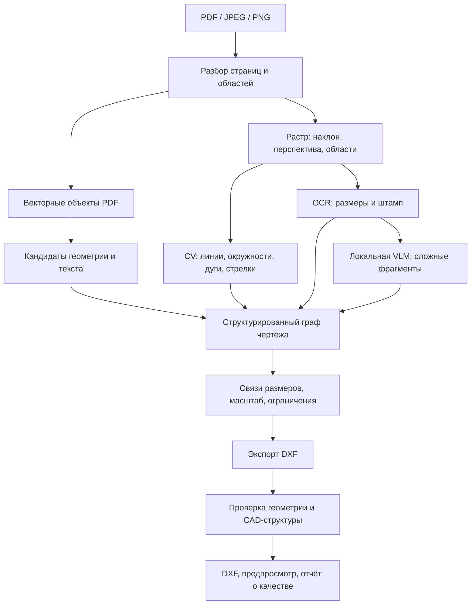

# Архитектура сервиса PDF/скан → редактируемый DXF

Уточнено 25.10.2026: учтены [клапан v2](valve-v2-cad-check.md), новый состав ролей, занятость 20 часов в неделю и дополнительный интерфейс VK. [План проекта](team-and-project-plan.md), [подробные задачи первого спринта](sprint-01-detailed-plan.md), [термины и схема хранения](terms-and-data-storage.md), [алгоритм восстановления](png-to-editable-dxf-algorithm.md).

## 1. Решение

Рекомендуется гибридный конвейер: извлечение векторных данных там, где они есть; компьютерное зрение и специализированный OCR для сканов; локальная мультимодальная модель для сложных фрагментов и интерпретации; отдельное геометрическое ядро для связей, ограничений и экспорта DXF.

Главный собственный компонент команды — структурированное представление чертежа и его восстановление из наблюдений. Готовые модели подключаются как заменяемые распознаватели. Это позволяет отдельно улучшать геометрию, чтение текста и связывание размеров, измеряя вклад каждого изменения.

| Вариант | Оценка для нашего проекта | Решение |
|---|---|---|
| Обучить универсальную модель PDF → DXF с нуля | 150 синтетических и 5 реальных пар дают слишком узкое покрытие чертежей и дефектов для такого подхода. Потребуются также другая разметка и значительные ресурсы | Не выбирать основой MVP |
| Готовая Qwen-VL генерирует весь DXF или программу его построения | Быстрое исследовательское демо, но точные координаты, полнота и корректность размерных связей остаются непроверенными | Использовать только как ограниченный эксперимент для сравнения |
| CV + OCR + геометрические правила | Проверяемая базовая линия; сложны мелкие обозначения, пересечения и связь размеров с деталями | Реализовать первой |
| Та же базовая линия + локальная VLM на сложных фрагментах | Позволяет использовать понимание изображения и текста, сохранив проверку геометрии и экспорт в собственном коде | Целевая архитектурная гипотеза; включение VLM подтвердить метриками |
| Дообучение готовых моделей на отдельных задачах | Полезно после выявления повторяемых ошибок и подготовки подходящей разметки | Следующий этап: детекция стрелок, OCR обозначений, связи размеров; затем при необходимости LoRA для VLM |

Недостаточность текущих данных относится к обучению универсального конвертера с нуля. Небольшой классификатор или дообучение специализированного детектора могут быть оправданы и на существенно меньших данных — это проверяется отдельно.

## 2. Что показали исходные данные и пробные восстановления

Количественные наблюдения ниже относятся к первичному аудиту `dataset/data`. Дополнительные каталоги `clear_sum_dataset`, `dataset2`, `dataset3` требуют общего реестра, проверки родства и повторной оценки состава данных.

- `болт1.pdf` содержит векторные пути и полезные текстовые аннотации. Для такого входа извлечение объектов сохраняет больше исходной информации, чем распознавание растровой копии. При этом PDF-пути сами по себе не содержат всех CAD-связей и размерных объектов.
- `drawing_001.pdf` содержит растровое изображение. В пробном восстановлении максимальное расхождение центров пяти отверстий с эталоном составило около 0,115 мм; диаметры задавались по визуально проверенным надписям. Совпадение диаметра не означает точного положения отверстия.
- В синтетическом эталоне `drawing_001.dxf` найдены нулевые отрезки, длинные диагональные линии и наложения текстов. Диагонали присутствуют и в эталоне: их нельзя автоматически считать исключительно шумом сканирования. Для обучения и метрик нужна политика обработки таких дефектов.
- В 150 синтетических `drawing_*.dxf` отсутствуют сущности `DIMENSION`: размеры представлены графикой и текстом. Автоматически получить полноценную разметку «размер → измеряемая геометрия» простым чтением этих файлов нельзя. Для пяти реальных DXF наличие `DIMENSION` тоже не заменяет аудит привязок и оформления.
- Обещанные 50–60 реальных пар пока нельзя считать доступными данными. Десять новых реальных листов для итоговой экспертной приёмки должны оставаться закрытой контрольной выборкой.
- Первая версия `клапан.png → DXF` содержала слои и размерные сущности, но фрагментированные контуры и графическая подмена размерных блоков не обеспечили ожидаемой редактируемости. Само наличие DIMENSION и похожая отрисовка не являются достаточными критериями качества.
- Одобренный пользователем клапан v2 показывает целевую структуру: замкнутые контуры с дугами, отдельные TEXT/HATCH, штатные размеры и независимо управляемые слои. Ручная интерпретация, специализированные построения и оставшиеся спорные места записаны в данных и отчёте; v2 служит примером и регрессией, не независимым доказательством автоматического качества или точности всех участков. Проверка изменения определяющей точки размера также не доказывает CAD-ассоциативность.

Следствие: сложнейшая часть проекта — установить смысл элементов и восстановить согласованную размерную геометрию. Преобразование уже известной геометрии в DXF — отдельная, более определённая задача.

## 3. Конвейер обработки

### 3.1. Приём и подготовка

API сохраняет оригинал, идентификатор задания и хеш файла. Единицей обработки является страница; для многостраничного документа формируется комплект результатов. Проверяются тип, доступность содержимого и лимиты размера/числа страниц.

Разборщик различает векторные, растровые и смешанные области. Полезный текст и векторные объекты извлекаются непосредственно; растровые области обрабатываются отдельно. Нельзя выбирать ветку только по расширению `.pdf` или наличию нескольких векторных элементов поверх скана.

Для растра определяются ориентация, наклон, перспективное искажение и области видов/штампа. Сохраняются все преобразования координат и исходное изображение. Обзорное изображение используется для разметки областей, фрагменты исходного разрешения — для мелких чисел и символов. Простое уменьшение всего A3 до небольшого изображения рискует потерять информацию.

Размер PDF-страницы или DPI даёт сведения о листе, но не доказывает масштаб детали. Нужно различать пиксели скана, координаты листа и физические миллиметры детали; у разных видов могут быть разные масштабы.

### 3.2. Распознавание наблюдений

Модуль геометрии выдаёт кандидаты линий, окружностей и дуг, их погрешности, типы линий, стрелки, выносные линии и пересечения. Первая реализация: OpenCV, контуры, преобразование Хафа, робастная аппроксимация. Штриховые линии необходимо собирать в логические элементы; символы текста отделять от геометрии. Обучаемые детекторы добавляются для конкретных слабых мест базовой линии.

OCR возвращает текст, область изображения и варианты распознавания. Отдельный парсер выделяет номинал, диаметр/радиус, допуски, резьбу, количество отверстий, единицы и масштаб. Исходная строка сохраняется: нормализация `Ø`, десятичной запятой или допуска не должна уничтожать оригинальное обозначение.

Начальный кандидат OCR — PaddleOCR с подходящей кириллической моделью. В официальном PP-OCRv5 есть `eslav_PP-OCRv5_mobile_rec` для русского, белорусского, украинского и английского; качество инженерных символов на наших чертежах нужно измерить отдельно. [Документация PaddleOCR](https://www.paddleocr.ai/main/en/version3.x/algorithm/PP-OCRv5/PP-OCRv5_multi_languages.html).

Штамп обрабатывается как структура полей: наименование, номер документа, материал, ФИО исполнителей. Для каждого значения сохраняются координаты источника. Нечитаемые поля остаются неопределёнными, а не заполняются наиболее правдоподобным материалом или фамилией.

### 3.3. Роль Qwen и агентной логики

Нужна модель с поддержкой изображений. Кандидаты для первого сравнения — Qwen3-VL-4B-Instruct и Qwen3-VL-8B-Instruct. Они имеют опубликованные веса и примеры локального применения. Выбор размера делается по качеству на наших фрагментах, времени и памяти. [4B](https://huggingface.co/Qwen/Qwen3-VL-4B-Instruct), [8B](https://huggingface.co/Qwen/Qwen3-VL-8B-Instruct).

Qwen3.5-9B — дополнительный мультимодальный кандидат, если более компактная конфигурация оставляет существенные ошибки. Его общие результаты на бенчмарках не являются проверкой преобразования инженерных чертежей в CAD. [Карточка Qwen3.5-9B](https://huggingface.co/Qwen/Qwen3.5-9B).

Полезные вызовы VLM: повторно прочитать сложное обозначение, разобрать ячейку штампа, предложить связь размерной надписи с одной из уже найденных стрелок/линий. На вход передаются фрагмент изображения, координаты и идентификаторы кандидатов; на выходе ожидаются данные по JSON-схеме, включая возможность неопределённого ответа.

Последовательность обработки задаёт программа. Для спорного фрагмента допустим ограниченный цикл: увеличить область → повторить OCR/VLM → проверить альтернативу. Начальный предел — один повтор после первой попытки, далее статус неопределённости. Число вызовов и общий бюджет времени фиксируются в конфигурации задания.

Такую логику можно назвать агентной, но для MVP достаточно конечного автомата на Python. Модель получает только необходимые операции чтения фрагмента и выбора кандидата; создание произвольных программ и прямое изменение DXF не являются её интерфейсом. Решение о корректности принимает валидатор по наблюдениям и ограничениям. Самооценка уверенности языковой модели не считается доказательством.

При выборе vLLM можно ограничивать ответ JSON-схемой. Это проверяет форму ответа, но не истинность числа или правильность выбранной геометрии. [Structured outputs в vLLM](https://docs.vllm.ai/en/latest/features/structured_outputs/).

### 3.4. Общее представление чертежа

Между распознаванием и экспортом вводится версионируемая схема `DrawingGraph` — обычные типизированные структуры Python/JSON, отдельная графовая БД не требуется. В задачах это называется «описание чертежа»: список геометрических объектов, текстов, размеров, штриховок и связей между ними. Полный документ сохраняется как `drawing.json`; [простое объяснение и пример](terms-and-data-storage.md).

| Раздел | Основное содержимое |
|---|---|
| `document`, `pages`, `views` | Идентификаторы, формат листа, положение видов, масштаб каждого вида, преобразования координат |
| `primitives` | Линии/окружности/дуги, параметры, система координат, роль сущности отдельно от типа линии, погрешность и происхождение |
| `contours`, `topology` | Упорядоченные рёбра и вершины, дуговые сегменты, замкнутость, отверстия, соседство, разрывы и самопересечения |
| `hatches`, `annotations` | Области штриховки со ссылками на контуры, угол/шаг; выноски, базы, шероховатость и условные обрывы отдельно от материала |
| `texts` | Исходная строка, альтернативы OCR, область и ориентация текста |
| `dimensions` | Тип, номинал, допуски, исходная надпись, стрелки, измеряемые объекты и точки, статус связи |
| `constraints` | Расстояние, диаметр, параллельность и другие отношения с указанием основания и статуса проверки |
| `title_block` | Значения обязательных полей, источник и статус распознавания |
| `issues`, `provenance` | Противоречия, неопределённости, ссылки на фрагменты; версии моделей, правил и параметров |
| `export_profile` | Сопоставление семантических ролей именам слоёв, типам сущностей и линий; правила модели/листа и проверяемые версии CAD |

Например, окружность хранит измеренный по изображению радиус и его неопределённость отдельно от прочитанного `Ø20`. Принятое ограничение `radius = 10 mm` записывается только после проверки связи надписи с этой окружностью. Подтверждённый диаметр не определяет автоматически точные координаты центра.

Номинал, формат подписи и измеряемые объекты хранятся раздельно. Стабильные идентификаторы связывают размер с геометрией, HATCH с границами, ошибку с областью исходника. Версия графа фиксируется до экспорта. Изменение подтверждённого параметра проходит проверку ограничений и перестроение связанных объектов; несогласованность переводит результат в `needs_review`. Конкретные DXF handles не заменяют идентификаторы общей модели.

### 3.5. Геометрическое ядро и размеры

Ядро связывает текст, стрелки, выносные линии и геометрию, определяет масштабы видов и решает систему ограничений. Проверенные номиналы задают точные ограничения; координаты, полученные из пикселей, используются как наблюдения с погрешностью. Геометрические отношения добавляются только при наличии основания на чертеже.

Перед экспортом ядро совместно с CV восстанавливает топологию: текст и штриховка исключаются из контура детали, близкие концы объединяются с контролем масштаба и сохранения пазов/отверстий, круговые дуги сохраняются аналитически. Материальные области задаются внешними и внутренними замкнутыми контурами; открытые видимые рёбра и условные обрывы остаются отдельными объектами. Проверяются замкнутость ожидаемых границ, самопересечения, нулевая площадь и дубли. Геометрию и связность собирает участник 6 (CV), текст и кандидаты размерных связей — участник 7 (OCR). Участник 3 (данные/CAD/QA) определяет правила и эталоны, участник 5 (backend) реализует общие проверки и экспорт. Аналитик описывает формат, техлид организует интеграцию и ревью.

Численный решатель, например на SciPy, полезен для подгонки параметров и анализа невязок. Для него необходимо проверять совместность ограничений и оставшиеся степени свободы: оптимизатор может вернуть красивое, но неоднозначное решение. Округление всех координат до целых миллиметров не является восстановлением размеров.

Если изображение даёт длину 139,7 мм, а надёжно прочитанный размер этого же отрезка равен 140 мм, ограничение позволяет восстановить 140 мм. Если надпись и геометрия противоречат друг другу либо связи неоднозначны, система сохраняет конфликт; замена отображаемого текста размера не должна маскировать неверную геометрию.

Требование заказчика о точности всех размеров сохраняется. Для нечитаемого или недостаточно определённого исходника нельзя гарантировать точное восстановление недостающей информации. Нужно согласовать критерии таких случаев и численные допуски вычислительной проверки. Согласованность чертежа по внутренним правилам также не доказывает совпадения с неизвестным оригиналом.

### 3.6. Экспорт и проверка

Экспортёр получает принятую версию `DrawingGraph` и создаёт AC1021, миллиметры, связные LINE/ARC/CIRCLE/LWPOLYLINE, TEXT/MTEXT, HATCH и настоящие DIMENSION. Семантические роли переводятся в слои через профиль: исходный набор `MAIN/THIN/AXIS/DIMS/TEXT` расширяется отдельными слоями штриховки, рамки, обозначений и видов. Имена `PART_MAIN/DIMENSIONS/SECTION_HATCH` из v2 имеют явное сопоставление; число 13 характеризует пример, а не любой чертёж.

Размеры используют определяющие точки, вычисляемое число (`<>` с форматированием), стиль и штатный анонимный блок отображения. Запрещены фиксированное число для маскировки неверной геометрии и подмена содержимого размерного блока трассировкой. Линии и текст внутри штатного блока допустимы; они принадлежат родительскому DIMENSION. Библиотека ezdxf позволяет создавать и отрисовывать размерные сущности. [Документация линейных размеров](https://ezdxf.readthedocs.io/en/stable/tutorials/linear_dimension.html).

Редактируемые сущности доступны в Model Space, весь лист не сворачивается в INSERT или изображение. Представление масштаба фиксируется в профиле и проверяется в первом спринте. Вариант с натуральной геометрией и layout/viewport сохраняет 100 мм в модели и 20 мм на листе при 1:5. Вариант v2 размещает выносной элемент 5:1 увеличенным в модели, с коэффициентом размеров 0.2; измерение модельной длины без учёта вида тогда не равно размеру детали. Эти варианты нельзя незаметно смешивать: координаты листа, модели и физические единицы явно разделены в DrawingGraph. Профиль выбирается по совместимости с конкретными версиями LibreCAD, OpenCADStudio, nanoCAD и исходными требованиями AutoCAD/DWG.

Наличие `DIMENSION` и автоматическая ассоциативность с изменяемой геометрией — разные свойства. Первое обязательно; требуемое поведение второго нужно уточнить на примере заказчика и проверить в САПР. Предыдущие демо не доказывают полной ассоциативности.

V2 принят как направление редактируемого 2D-результата, а не как подтверждение параметрического 3D или следования размеров за контуром во всех CAD. В первом спринте фиксируется объём CAD-ассоциативности; её обязательная реализация потребует отдельной оценки адаптеров и сроков. Перестроение графа внутри сервиса и ассоциативность внутри внешней CAD проверяются раздельно.

Проверки результата: повторное чтение и аудит DXF, типы сущностей, единицы/масштаб/лист, соответствие размерных значений измеряемой геометрии, вырожденные/дублирующие элементы, полнота относительно наблюдений. Наложение отрисованного DXF на исходник помогает локализовать ошибки, но визуальное сходство не заменяет проверку чисел и связей.

Дополнительно обязательны отрисовка только геометрии, проверка замкнутости и самопересечений, границ HATCH, независимого управления слоями и совпадения числа в определении/отображении размера. Контрольный тест изменяет определяющую точку: 46 → 47 с пересозданием графики. GUI-протокол отдельно проверяет выбор и изменение контура, текста, размера и HATCH, затем сохранение/повторное открытие. По каждой CAD и версии фиксируется `passed/failed/not_run`; библиотечный аудит не заменяет GUI-проверку. Подробный перечень операций — в [плане](team-and-project-plan.md) и [инструкции v2](valve-v2-cad-check.md).

Пользователь получает DXF, предпросмотр и список проблем с привязкой к исходнику. Для спорных результатов предлагается статус «требуется проверка» и возможность исправления данных. Такой сценарий нужно согласовать как часть продукта: ручная коррекция не должна скрыто засчитываться как успешное автоматическое распознавание.

## 4. Развёртывание MVP

Один репозиторий, модульный Python-код; API и тяжёлый обработчик запускаются отдельными процессами. Базовый Docker Compose объединяет `api`, `worker` и `db`; `vlm` и `vk-bot` включаются отдельно:

| Компонент | Назначение |
|---|---|
| `api` | FastAPI, загрузка, статус, выдача артефактов; раздача собранного веб-интерфейса |
| `worker` | Выполнение этапов конвейера, CV/OCR, геометрическое ядро, DXF и проверки |
| `db` | PostgreSQL: задания, состояния, версии результатов и ссылки на артефакты |
| `vlm`, необязательный | Локальное выполнение выбранной мультимодальной модели; подключается через адаптер после проверки полезности |
| `vk-bot`, необязательный | Получение вложения из VK, вызов того же API, отправка DXF и предупреждений в исходный диалог |

Оригиналы, фрагменты и результаты хранятся в постоянном локальном томе, общем для API и worker; веса — в отдельном томе. Предлагаемое дерево: `jobs/<job_id>/input/original.<ext>` и `jobs/<job_id>/runs/<run_id>/` с `drawing.json`, `result.dxf`, `preview.png`, `report.json` и промежуточными данными. Оригинал — именно загруженный пользователем PDF/PNG/JPEG, без изменения байтов. PostgreSQL хранит `jobs`, `runs`, `artifacts`: состояния, параметры, версии, принадлежность заданий, относительные пути и хеши. Полный DrawingGraph остаётся в JSON-файле, второй независимо редактируемой копии в базе нет. Версия структуры JSON и номер повторной обработки — разные поля. [Подробная схема и правила записи](terms-and-data-storage.md).

На старте достаточно одного обработчика и одного задания одновременно. Долгое задание не удерживает HTTP-запрос: API возвращает идентификатор. В первом спринте поддерживаются один лист PNG/JPEG/PDF, ручной повтор через API и сохранение ошибки; автоматическое восстановление зависших заданий развивается далее.

VK-бот — отдельный серверный адаптер, а не второй конвейер распознавания. Он хранит связь события/диалога с заданием, не выдаёт результат в чужой диалог, предотвращает повторное создание задания при повторе события. Токен хранится вне репозитория и браузера. Бот требует интернета; отключение этого компонента не влияет на локальный сайт и обработку. В первом спринте проверяются права тестового сообщества и возможность передачи DXF, затем интеграция на синтетическом документе. Базовые механизмы доступны в официальных схемах VK: [события сообществ](https://github.com/VKCOM/vk-api-schema/blob/master/groups/methods.json), [документы](https://github.com/VKCOM/vk-api-schema/blob/master/docs/methods.json); конкретные ограничения проверяются до разработки полного маршрута.

Для MVP таблица заданий PostgreSQL может служить устойчивой очередью: атомарное получение задания, отметка активности, ограниченные повторы после сбоя. Этапы сохраняют контрольные результаты; повторная обработка создаёт новую версию, а не портит уже выданную. При увеличении нагрузки интерфейс очереди позволит подключить отдельный брокер.

Рабочие состояния: `queued → running → succeeded / needs_review / failed`. `succeeded` означает прохождение реализованных автоматических проверок, а не сертификат безошибочности исходной реконструкции. У страницы и всего задания могут быть разные статусы.

Начальные технологические кандидаты: pypdf для разбора PDF, PDFium/pypdfium2 для рендеринга, OpenCV/NumPy/SciPy для изображения и геометрии, PaddleOCR, Qwen, Pydantic для контрактов, ezdxf для экспорта. PDFium поддерживает рендеринг страниц и работу с объектами и текстом. [pypdfium2](https://github.com/pypdfium2-team/pypdfium2).

Для VLM сначала удобен экспериментальный адаптер Transformers; серверный runtime выбирается по поддержке конкретных весов и измерениям памяти. Один из компактных вариантов — официальная GGUF-версия Qwen3-VL-4B-Instruct для llama.cpp: нужно поставлять и языковые веса, и визуальный компонент `mmproj`. GGUF не следует считать взаимозаменяемым с любым форматом квантования другого runtime. [Официальные GGUF-веса](https://huggingface.co/Qwen/Qwen3-VL-4B-Instruct-GGUF).

### Аппаратные профили — гипотезы для проверки

| Условия | Старт эксперимента | Что измеряем |
|---|---|---|
| GPU 16 ГБ | Квантизованная VLM 4B, один фрагмент за вызов, OCR/CV преимущественно на CPU | Пиковая VRAM/RAM, ошибки мелких символов, время полного листа |
| GPU 24 ГБ | Сравнить тот же 4B с квантизованным 8B; 9B — при полезном приросте качества | Прирост точности относительно 4B и стоимость по времени/памяти |
| CPU-only | CV/OCR-конвейер; отдельно испытать компактную VLM на сложных фрагментах | Достижимость ориентира 5–10 минут и изменение качества |

Это не гарантии размещения модели или скорости. Память требуется также визуальному кодировщику, промежуточным тензорам, контексту и runtime. В CPU-профиле отключение VLM может ухудшить результат; такой профиль оценивается отдельно. Фактическое время полного листа, включая подготовку и проверки, фиксируется в README вместе с оборудованием.

Автономный комплект содержит образы с фиксированными версиями, веса, токенизаторы/процессоры, OCR-ресурсы, шрифты, конфигурации, лицензии и инструкцию запуска. Приёмка установки проводится с отключённым интернетом. Для воспроизводимости задания фиксируются хеш исходника, версии кода/моделей/промптов и параметры обработки; технические логи дополняются длительностями этапов и использованием памяти.

## 5. Данные и обучение

1. Составить реестр пар и провести аудит эталонов. Разделить пригодные исходные элементы, дефекты генерации и неоднозначные случаи; сохранить исходные эталоны и историю исправлений.
2. Разбивать данные по исходным деталям/геометрическим шаблонам до создания искажений. Варианты одного исходного CAD-чертежа не должны одновременно попадать в обучение и контроль. Похожие топологии нужно учитывать при анализе обобщения.
3. Добавить разметку размерных связей: числовые значения, стрелки, выносные линии, измеряемые точки/объекты, тип размера, масштаб и поля штампа. Существующие `LINE/TEXT` могут помогать подготовке кандидатов, но нуждаются в проверке.
4. Расширить параметрический генератор: сначала строить корректную CAD-геометрию и настоящие размерные объекты с известными связями, затем печатать и искажать изображение. Генератор должен отдавать также JSON-разметку. Увеличение числа искажений одного листа не равно увеличению разнообразия деталей.
5. Собирать реальные ошибки на отдельной рабочей выборке: неверный символ, пропущенная дуга, перепутанная размерная связь, сложный штамп. По ним выбирать конкретный компонент для дообучения.
6. Сначала проверить дообучение детектора/распознавателя. LoRA/QLoRA для VLM рассматривать при достаточном количестве проверенных примеров и устойчивом классе ошибок, который не устраняется подготовкой изображения и правилами. Число нужных примеров заранее не обещается; решение принимается по кривой обучения и отдельной валидации.

Исходных 155 пар достаточно для организации базового эксперимента и анализа ошибок. Они не обосновывают обещание универсального качества на реальных архивах. Пять реальных пар дают лишь предварительную оценку с большой неопределённостью; новые реальные данные критичны для проверки обобщения.

## 6. Эксперимент первого спринта

Первый приоритет спринта — доказать два раздельных результата: контрольный DrawingGraph экспортируется в редактируемый DXF с проверенным поведением, а узкий маршрут распознавания реального входа формирует данные этого контракта. Клапан v2 сокращает работу над примерами экспортёра, но не закрывает автоматизацию распознавания и общий формат ядра. При занятости 20 часов в неделю на человека минимальный объём — два контрольных описания для экспорта и три простых входа для автоматического маршрута. Экспорт включает геометрию, текст, линейный размер, HATCH и слои; более сложные типы развиваются далее. На человека — 32 часа задач и 8 часов встреч/исправлений/резерва.

Сравнение вклада локальной VLM запланировано после базового маршрута, начиная со второго спринта. В первый спринт оно возможно только при завершённом обязательном объёме и свободной ёмкости; в 32 часа основных задач оно не включено.

Сравниваются на одинаковых входах и разбиении:

- **A — базовая линия:** извлечение PDF/CV + OCR + геометрические правила + DXF.
- **B — гибрид:** тот же конвейер, дополненный VLM для трудных фрагментов и предложений размерных связей.
- **C — факультативная проверка идеи:** ограниченный по времени эксперимент VLM → структурированное описание всего листа → тот же экспортёр. Результат нужен для измерения потерь/галлюцинаций, если команда хочет проверить прямой подход.

Для дальнейшего сравнения рабочий набор должен покрывать все пять типов синтетических деталей, разные искажения и доступные реальные сканы. В первом спринте выбираются 8 рабочих листов, из них 3 простых размечаются подробно; это ограниченный набор для интеграции, не доказательство обобщающего качества. `болт1`, его растровая версия, `drawing_001` и `клапан`, уже разобранные вручную, подходят для отладки и регрессии, но не для независимого доказательства качества. Включая новые каталоги данных, следует проверить дубликаты этих листов и родственные варианты. Итоговые десять приёмочных листов не используются. Точные объёмы рабочих разбиений фиксируются после аудита родства примеров.

| Метрика | Что проверяет |
|---|---|
| Precision/recall геометрических примитивов | Пропуски и лишние элементы при явно заданных правилах сопоставления |
| Топология и классы сущностей | Замкнутость ожидаемых контуров, разрывы, самопересечения, отделение текста/штриховки от детали, правильность CAD-типа |
| Ошибки координат, радиусов, длин | Фактическую геометрию в мм, отдельно от текста размера |
| Точное совпадение размерного обозначения | Номинал, диаметр/радиус, допуски и значимые символы |
| Правильность связей размеров | К каким объектам/точкам относится размер |
| Полнота и точность полей штампа | Обязательные архивные сведения |
| Проверки DXF и редактирования в САПР | Слои, формат, масштаб/лист; изменение контура, строки, размерной точки и HATCH; соответствие отображаемого числа измерению и сохранение типов после повторного открытия |
| Время, RAM/VRAM, доля ручной проверки | Пригодность для целевого локального сервера |

Пороговые допуски и правила сопоставления должны быть опубликованы до сравнения. Неопределённые/отклонённые элементы считаются при оценке полноты; дополнительно показываются качество принятых результатов и доля автоматической обработки. Ручные исправления учитываются отдельно. Для небольшого набора приводятся результаты по каждому листу, а не только среднее число.

VLM включается в основной профиль, если на рабочем контроле даёт воспроизводимый выигрыш в целевых ошибках или снижает объём ручной проверки при приемлемых ресурсах. Если выигрыш отсутствует, архитектура позволяет оставить CV/OCR и доработать конкретное слабое место.
